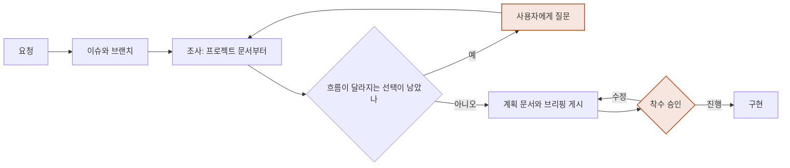
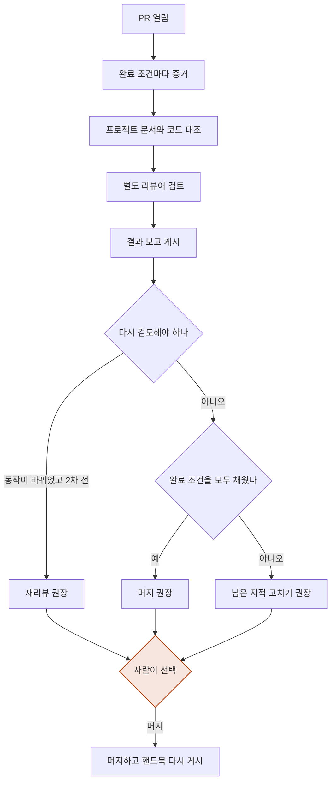
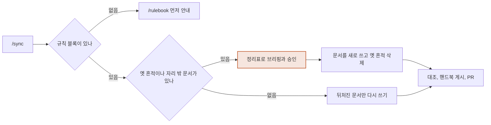

<!-- logbook:system sources="skills/** hooks/** agents/** templates/agents-block.md templates/plan.md" -->
# 주요 흐름

## 흐름 목록

프로젝트마다 한 번 `/rulebook`으로 규칙을 설치한 뒤에는, 모든 변경이 브리핑과 결과 보고를 거치고 프로젝트 문서는 `/sync`로 코드와 맞춥니다.

```html
<div class="cards">
  <div class="card"><b>구현 전 브리핑</b><p>조사하고, 흐름이 달라지는 선택은 묻고, 계획을 승인받습니다</p></div>
  <div class="card"><b>화면 시안 승인</b><p>화면이 바뀌면 구현 전에 시안을 승인받습니다</p></div>
  <div class="card"><b>구현 후 결과 보고</b><p>증거, 문서 대조, 별도 리뷰를 거쳐 머지를 고릅니다</p></div>
  <div class="card"><b>문서 동기화</b><p>옛 흔적을 정리하고 프로젝트 문서를 코드에 맞춥니다</p></div>
</div>
```

## 구현 전 브리핑

요청이 들어오면 조사하고, 사용 흐름이 달라지는 선택은 사용자에게 묻고, 계획을 슬라이드로 보고해 착수 승인을 받습니다.



- 들어오는 길은 세 가지이고 승인 방법이 다릅니다. 직접 요청은 "진행" 답변, 플랜 모드는 플랜 승인, `/mission`은 출력된 `/goal` 문장의 실행이 승인입니다.
- 플랜 모드에서는 hook이 브리핑 블록이 없는 플랜을 되돌려 보내고, 있으면 브라우저로 미리 보여 줍니다.
- 시작점: `skills/brief/SKILL.md`, `skills/mission/SKILL.md`, `hooks/plan-preview.sh`

## 화면 시안 승인

화면을 새로 만들거나 크게 바꾸는 변경은, 계획을 쓰기 전에 시안을 만들어 승인받고 그 사본을 따라 구현합니다.

```html
<div class="tracks">
  <div class="track"><div class="who">시안</div><div class="steps"><span class="step">캔버스에 화면 그리기</span><span class="arrow">→</span><span class="step human">검토</span><span class="arrow">→</span><span class="step">고쳐 달라면 다시 그리기</span><span class="arrow">→</span><span class="step human">승인</span><span class="arrow">→</span><span class="step done">사본 저장</span></div><div class="count">docs/designs/</div></div>
</div>
```

- Claude Code에서는 `/design`과 같은 Design 캔버스를 쓰고, 캔버스를 쓸 수 없는 곳에서는 HTML 파일로 시안을 만듭니다.
- 플랜 모드와 `/mission`은 읽기 전용 단계라 시안을 올릴 수 없어서, 계획을 승인받은 뒤에 시안을 만듭니다.
- 시작점: `skills/brief/SKILL.md`의 시안 단계

## 구현 후 결과 보고

PR을 열면 완료 조건마다 증거를 모으고, 프로젝트 문서를 코드와 대조하고, 별도 리뷰어의 검토를 거친 뒤 사람이 다음 단계를 고릅니다.



- PR 본문에 결과 보고 표시(`<!-- logbook:debrief -->`)가 없으면, 대화를 끝낼 때 hook이 한 번 막고 `/debrief`를 실행하라고 알려 줍니다.
- 리뷰는 PR마다 한 번 하고, 리뷰 뒤 고친 내용이 동작을 바꾸면 고친 부분만 한 번 더 봅니다.
- 시작점: `skills/debrief/SKILL.md`, `agents/reviewer.md`, `hooks/debrief-gate.sh`

## 문서 동기화

`/sync`는 기존 프로젝트에서는 옛 흔적을 정리하고 프로젝트 문서를 새로 쓰며, logbook을 쓰던 프로젝트에서는 코드보다 뒤처진 문서만 다시 씁니다.



- 문서마다 첫 줄에 적은 코드 경로를 보고, 그 코드가 문서보다 나중에 바뀌었으면 "뒤처짐"으로 판단합니다.
- 시작점: `skills/sync/SKILL.md`, `scripts/legacy_scan.py`, `scripts/system_check.py`
