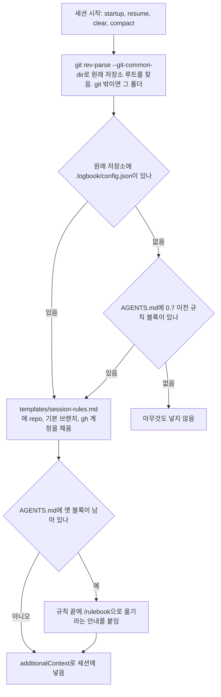
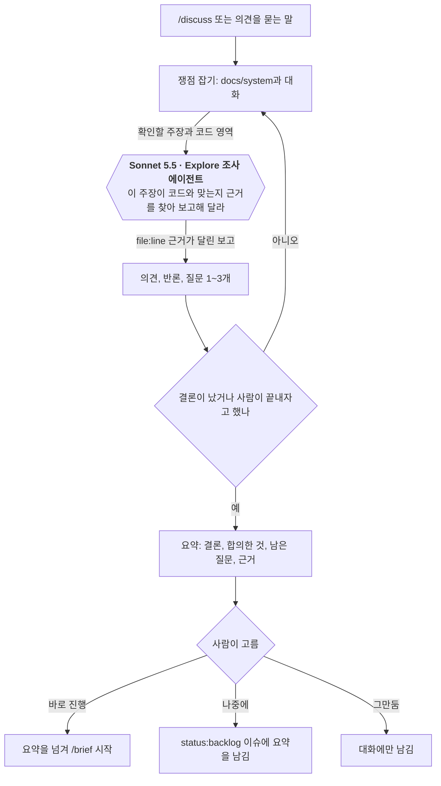
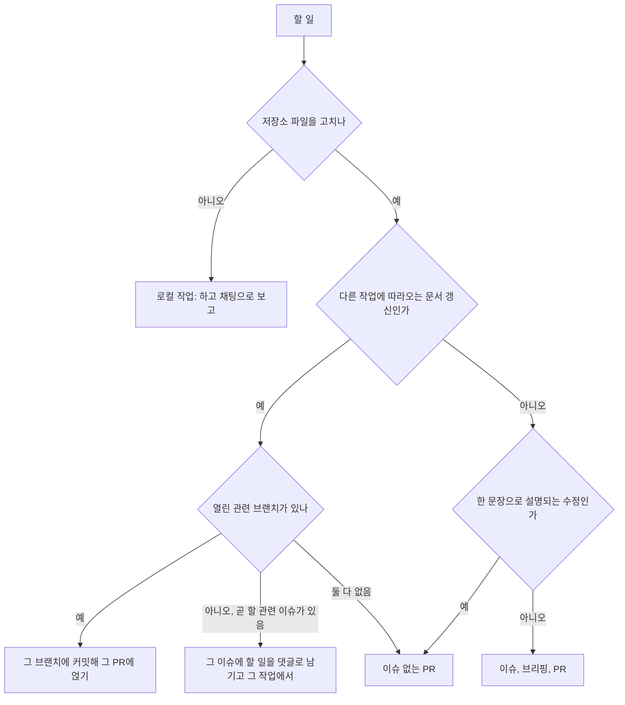
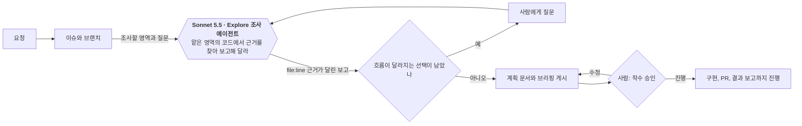
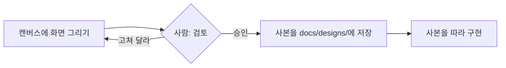
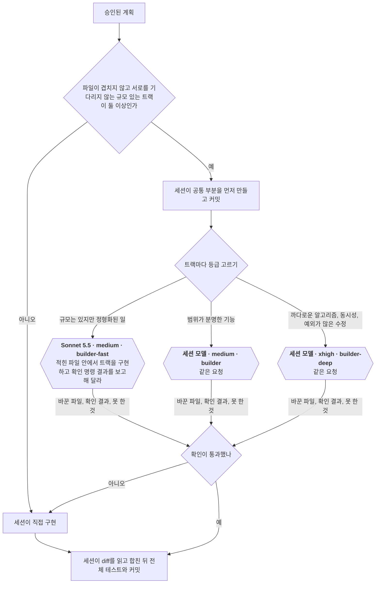
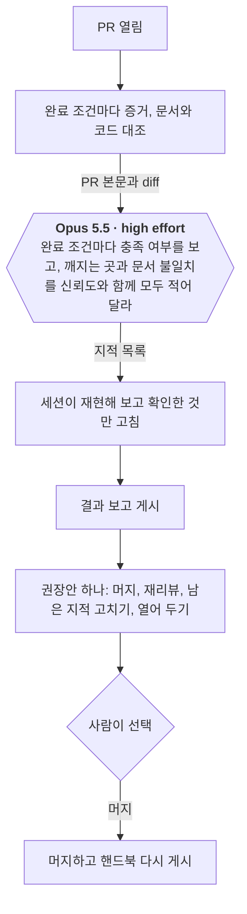
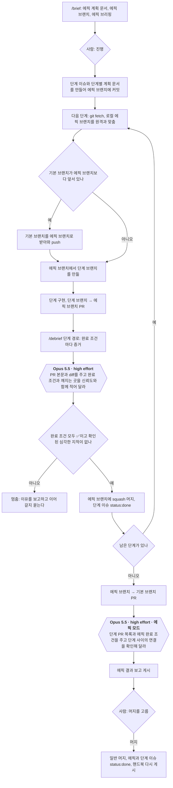
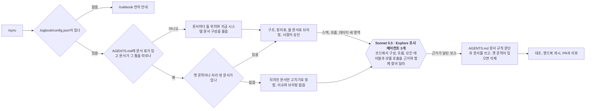

<!-- logbook:system sources="skills/** hooks/** agents/** templates/session-rules.md templates/docs-rules.md scripts/rulebook.sh templates/plan.md templates/parallel.md" -->
# 주요 흐름

## 흐름 목록

clone마다 한 번 `/rulebook`으로 logbook을 켜면 세션마다 작업 규칙이 들어가고, 이슈로 남길 변경은 브리핑과 결과 보고를 거치고, 작은 수정은 이슈 없이 PR만 남기며, 프로젝트 문서는 `/sync`로 코드와 맞춥니다. 무엇을 만들지 정하기 전에는 `/discuss`로 토론할 수 있고, 여러 단계로 나뉜 긴 작업(에픽)은 에픽 브랜치에서 한 번에 진행합니다.

| 흐름 | 한 줄 설명 |
|---|---|
| logbook 켜기와 세션 규칙 | `/rulebook`이 켜는 표시를 만들고, 세션이 시작될 때마다 hook이 플러그인의 규칙을 넣습니다 |
| 구현 전 토론 | 아무것도 고치지 않고 아이디어를 따져 본 뒤, 넘기기·backlog·남기지 않기 중 하나를 고릅니다 |
| 이슈로 남길지 정하기 | 다른 개발자가 알아야 하거나 꼭 남길 작업만 이슈가 되고, 나머지는 PR만 열거나 관련 PR에 얹거나 채팅으로 보고합니다 |
| 구현 전 브리핑 | 조사하고, 흐름이 달라지는 선택은 묻고, 계획을 승인받습니다 |
| 화면 시안 승인 | 화면이 바뀌면 구현 전에 시안을 승인받습니다 |
| 구현과 병렬 트랙 | 이득이 있을 때만 구현을 트랙으로 나눠 builder 에이전트에 동시에 맡기고, 서브에이전트나 Workflow로 띄웁니다 |
| 구현 후 결과 보고 | 증거, 문서 대조, 별도 리뷰를 거쳐 머지를 고릅니다 |
| 에픽 진행 | 브리핑을 승인한 세션이 단계를 차례로 에픽 브랜치에 합치고, 마지막 에픽 PR에서 한 번 보고합니다 |
| 문서 동기화 | 문서 구조를 정하고, 옛 흔적을 정리하고, 프로젝트 문서를 코드에 맞춥니다 |

## logbook 켜기와 세션 규칙

`/rulebook`은 clone마다 한 번 logbook을 켜고, 그 뒤로는 세션이 시작될 때마다 hook이 플러그인의 최신 규칙을 넣습니다. 규칙이 저장소에 없으므로 플러그인을 올려도 프로젝트에서 할 일이 없습니다.

- `/rulebook`은 `.logbook/config.json`(repo, 기본 브랜치, gh 계정), `.gitignore`의 `.logbook/`, 이슈 라벨, 변경 기록 폴더와 `plansDirectory`를 준비합니다. AGENTS.md는 0.7 이전 규칙 블록이 있을 때만 고칩니다. 블록 자리에 그 안의 문서 규칙을 일반 문단(`templates/docs-rules.md`)으로 옮겨 씁니다.
- `.logbook/`은 git에서 제외되어 clone에 따라오지 않습니다. 새로 clone한 저장소는 `/rulebook`을 실행하기 전까지 규칙이 들어가지 않고, 경고도 없습니다. worktree는 원래 저장소의 설정을 읽으므로 따로 켤 필요가 없습니다. worktree에서 `/rulebook`을 실행하면 설정을 원래 저장소에 쓰고, 원래 저장소의 `.git/info/exclude`에 `.logbook/`을 넣습니다.
- 플랜 미리보기와 결과 보고 hook도 같은 판정(`hooks/lib.sh`)으로 logbook 저장소인지 정합니다. git 밖 폴더는 세션 규칙과 플랜 미리보기만 그 폴더 자체를 보고(하위 폴더는 보지 않습니다), 결과 보고 hook은 PR이 없으므로 동작하지 않습니다.
- hook 출력은 Claude Code가 한 번에 10,000자까지 그대로 넣습니다. 규칙은 약 4,200자이고, `tests/run.sh`가 한도를 넘지 않는지 확인합니다.
- 시작점: `hooks/session-rules.sh`, `hooks/lib.sh`, `scripts/rulebook.sh`, `skills/rulebook/SKILL.md`

## 구현 전 토론

`/discuss`나 의견만 묻는 말이 들어오면, 에이전트는 파일과 이슈를 건드리지 않은 채 근거를 대며 토론하고, 결론이 나면 사람이 끝맺음을 고릅니다.

- 에이전트는 근거가 있으면 동의하고, 근거가 반대쪽이면 자신 있게 반론합니다. 일부러 반대하지는 않습니다.
- 끝맺음을 고르기 전까지 파일 수정, 커밋, 이슈와 브랜치, Artifact 게시, 플랜 모드, `/debrief`를 쓰지 않습니다. hook으로 막지는 않고 스킬 문구로 지킵니다. 디브리핑 없는 열린 PR이 있는 브랜치에서 토론하면 결과 보고 hook이 턴마다 `/debrief`를 요구하지만, 토론 중에는 한 줄로 알리기만 합니다.
- 토론 중 "해 줘"가 나오면 바로 고치지 않고 끝맺음으로 가서 `/brief`로 넘기기를 권합니다.
- `/brief`는 토론 요약의 결정을 사용자가 정한 것으로 옮기고 남은 질문만 묻습니다. backlog 이슈를 받으면 라벨을 `status:todo`로 바꿉니다.
- logbook 규칙의 "의견을 묻는 말에는 토론으로 답한다" 때문에 명령 없이 의견을 물어도 에이전트가 `/discuss` 스킬을 불러 같은 흐름을 탑니다. 할 일인지 의견인지 애매하면 에이전트가 한 줄로 묻습니다.
- 시작점: `skills/discuss/SKILL.md`, `templates/session-rules.md`

| 모델 호출 | 모델(설정) | 넣는 것 | 요청(프롬프트 요지) | 받는 것과 검사 | 실패하면 |
|---|---|---|---|---|---|
| 토론 | 세션 모델(사용자가 고른 모델) | 사람의 말, 조사 보고, `docs/system/` | 근거를 대며 의견과 반론을 말하고 쟁점을 짚는 질문을 한다(`skills/discuss/SKILL.md`) | 대화 답변. 사람이 읽고 반박합니다 | 해당 없음 |
| 코드 조사 | Sonnet 5.5 Explore 에이전트(서브에이전트나 Workflow, `templates/parallel.md`의 모델 표. 다른 하네스는 세션 모델) | 확인할 주장과 코드 영역 | 코드에서 주장이 맞는지 근거를 찾아 `file:line`과 함께 보고한다 | 영역별 보고. 결론에 쓰이는 근거는 세션이 파일을 직접 읽어 다시 확인합니다 | 세션이 직접 읽습니다 |

## 이슈로 남길지 정하기

할 일이 들어오면 에이전트는 먼저 이 작업을 이슈로 남길지 정합니다. 다른 개발자가 알아야 하거나 꼭 남겨야 하는 작업(기능, 버그 수정, 설계 변경, 나중에 할 일)만 이슈와 브리핑을 거칩니다. 한 문장으로 설명되는 작은 수정은 버그 수정이라도 이슈 없이 PR만 엽니다.

- 로컬 작업은 도구 설치, 로컬 서비스 정지, 그 기기의 설정 파일처럼 저장소를 고치지 않는 일입니다. 다른 개발자도 같은 준비를 해야 하면 그 내용만 `docs/system/stack.md`에 남기고, 이 갱신은 따라오는 문서 갱신으로 처리합니다.
- 이슈 없는 PR은 `<type>/<slug>` 브랜치에서 엽니다. 기본 브랜치에 직접 커밋하지 않는 규칙은 그대로입니다. 계획 문서가 없는 PR은 `/debrief`가 결과 HTML 없이 PR 본문에 증거를 남기고, 한 문장 수정이 아니면 독립 리뷰는 그대로 합니다.
- 곧 할 이슈로 미룬 문서 갱신은 그 이슈의 댓글에 남습니다. 그 이슈로 `/brief`나 플랜 모드를 시작하면 댓글을 읽어 같은 변경에 넣습니다.
- 어느 쪽인지 애매하면 에이전트가 작업 전에 한 줄로 묻습니다.
- 시작점: `templates/session-rules.md`의 "이슈는 남길 일에만 만든다", `skills/brief/SKILL.md`의 건너뛰는 경우

## 구현 전 브리핑

요청이 들어오면 조사하고, 사용 흐름이 달라지는 선택은 사용자에게 묻고, 계획을 슬라이드로 보고해 착수 승인을 받습니다. 승인한 뒤에는 다시 승인을 묻지 않고 PR과 결과 보고까지 진행합니다.

- 사람의 답이 조사 결과, 비용, 위험, 본인이 밝힌 목표와 어긋나 보이면 에이전트가 한 번 걱정과 근거, 더 나은 안을 알립니다. 그대로 가겠다고 하면 따르고 계획 문서에 "알린 우려"로 남깁니다.
- 들어오는 길은 세 가지이고 승인 방법이 다릅니다. 직접 요청과 `/discuss`에서 넘긴 요청은 "진행" 답변, 플랜 모드는 플랜 승인이 착수 승인입니다. `/discuss`에서 넘어오면 토론 요약의 결정은 다시 묻지 않습니다.
- 플랜 모드에서는 hook이 브리핑 블록이 없거나 HTML이 든 플랜을 되돌려 보내고, 문제가 없으면 브라우저로 미리 보여 줍니다.
- 조사 에이전트는 영역이 둘이면 서브에이전트로, Workflow를 쓸 수 있고 영역이 셋 이상이면 Workflow로 띄웁니다. 어느 쪽인지 채팅에 한 줄로 적습니다(`templates/parallel.md`). `/discuss`와 `/sync`의 조사도 같습니다.
- 여러 단계로 나뉘는 작업은 `/brief`가 에픽(`epic` 라벨 이슈, 에픽 브랜치)으로 계획합니다. 단계 이슈와 단계 계획 문서는 승인 뒤에 만들고, 슬라이드는 에픽 계획 문서에만 만듭니다. 승인 뒤에는 아래 "에픽 진행"을 따릅니다.
- 시작점: `skills/brief/SKILL.md`, `hooks/plan-preview.sh`

| 모델 호출 | 모델(설정) | 넣는 것 | 요청(프롬프트 요지) | 받는 것과 검사 | 실패하면 |
|---|---|---|---|---|---|
| 코드 조사 | Sonnet 5.5 Explore 에이전트(서브에이전트는 `model: sonnet`, Workflow는 `agentType: 'Explore', model: 'sonnet'`, `templates/parallel.md`. 다른 하네스는 세션 모델) | 조사할 영역과 질문 | 맡은 영역의 코드에서 근거를 찾아 `file:line`과 함께 보고한다 | 영역별 보고서. 프로젝트 문서는 세션이 먼저 읽고, 바뀔 파일도 세션이 직접 읽어 보고를 다시 확인한다 | 보고가 빠지거나 틀려도 세션이 바뀔 파일을 직접 읽는 단계에서 걸린다 |

## 화면 시안 승인

화면을 새로 만들거나 크게 바꾸는 변경은, 계획을 쓰기 전에 시안을 만들어 승인받고 그 사본을 따라 구현합니다.

- Claude Code에서는 `/design`과 같은 Design 캔버스를 쓰고, 캔버스를 쓸 수 없는 곳에서는 HTML 파일로 시안을 만듭니다.
- 플랜 모드는 읽기 전용 단계라 시안을 올릴 수 없어서, 계획을 승인받은 뒤에 시안을 만듭니다.
- 시작점: `skills/brief/SKILL.md`의 시안 단계

## 구현과 병렬 트랙

승인 뒤 구현은 세션이 직접 하는 것이 기본이고, 독립적이고 규모 있는 트랙이 둘 이상일 때만 나눠서 builder 에이전트에 동시에 맡깁니다.

- 한 줄로 이어진 작업, 몇 번 만에 끝나는 일, 설계 결정, 원인을 모르는 버그, 사람에게 물어야 할 수 있는 일은 나누지 않습니다. 하위 에이전트는 사람에게 질문할 수 없습니다.
- 트랙은 서브에이전트나 Workflow(여러 에이전트를 JavaScript 스크립트로 띄우는 Claude Code 도구)로 띄웁니다. 트랙이 둘이면 서브에이전트, Workflow를 쓸 수 있고 트랙이 셋 이상이거나 끊겨도 이어 받아야 하는 긴 작업이면 Workflow입니다. Workflow는 트랙마다 확인 결과를 정해진 형식으로 돌려주고, 끊기면 이어서 실행합니다. 어느 쪽이든 같은 builder 등급과 모델을 쓰고, 무엇으로 띄울지는 브리핑의 일정 장에 적습니다. Workflow를 쓸 수 없으면 서브에이전트로 띄웁니다.
- 두 방식 모두 같은 작업 트리를 씁니다. 그래서 트랙끼리 파일이 겹치지 않아야 하고, 트랙의 확인 명령은 그 트랙의 파일만 검사합니다.
- 결과 보고에 트랙마다 맡은 에이전트, 띄운 방식, 결과, 걸린 시간을 적습니다.
- 시작점: `templates/session-rules.md`의 "구현은 이득이 있을 때만 나눈다", `templates/parallel.md`, `agents/builder.md`, `agents/builder-fast.md`, `agents/builder-deep.md`

| 모델 호출 | 모델(설정) | 넣는 것 | 요청(프롬프트 요지) | 받는 것과 검사 | 실패하면 |
|---|---|---|---|---|---|
| 병렬 구현 트랙 | `builder-fast`는 Sonnet 5.5와 medium, `builder`는 세션 모델과 medium, `builder-deep`은 세션 모델과 xhigh(각 파일의 `model`, `effort`. Workflow는 `agent()`의 `agentType`, `model`, `effort`에 같은 값을 적습니다) | 트랙 목표, 고칠 파일 목록, 먼저 만든 공통 부분, 확인 명령, 계획 문서 경로 | 적힌 파일 안에서만 구현하고 확인 명령을 돌린다. 범위를 넓히지 않고, 모호하면 멈추고 보고한다. 커밋하지 않는다 | 바꾼 파일, 확인 명령 출력, 못 한 것, 스스로 정한 것. 세션이 diff를 읽고 합친 뒤 전체 테스트를 돌린다 | 다시 맡기지 않고 세션이 이어받는다. 이 에이전트가 없는 하네스에서는 세션이 직접 구현한다 |

## 구현 후 결과 보고

PR을 열면 완료 조건마다 증거를 모으고, 프로젝트 문서를 코드와 대조하고, 별도 리뷰어의 검토를 거친 뒤 사람이 다음 단계를 고릅니다.

- PR 본문에 결과 보고 표시(`<!-- logbook:debrief -->`)가 없으면, 대화를 끝낼 때 hook이 한 번 막고 `/debrief`를 실행하라고 알려 줍니다.
- 리뷰는 PR마다 한 번 하고, 리뷰 뒤 고친 내용이 동작을 바꾸면 고친 부분만 한 번 더 봅니다.
- 문서 대조 범위는 PR의 실제 base입니다(`system-check.sh --range origin/<PR base>...HEAD`).
- 에픽의 단계 PR과 에픽 PR은 다음 절 "에픽 진행"의 경로를 탑니다.
- 시작점: `skills/debrief/SKILL.md`, `agents/reviewer.md`, `hooks/debrief-gate.sh`

| 모델 호출 | 모델(설정) | 넣는 것 | 요청(프롬프트 요지) | 받는 것과 검사 | 실패하면 |
|---|---|---|---|---|---|
| 별도 리뷰 | Opus 5.5, high effort(`agents/reviewer.md`의 `model: opus`, `effort: high`) | PR 본문의 완료 조건, diff | 완료 조건마다 충족 여부, 정상 경로에서 깨지는 곳, 프로젝트 문서와 코드의 불일치, 모델 호출 설명 누락, md 안의 HTML을 찾는다. 읽기 도구만 쓴다 | 지적마다 `file:line`, 설명, 신뢰도(0~100), 확인 방법. 세션이 재현해 보고, 확인했거나 80점 이상인 것만 남긴다 | 다른 하네스에서는 세션 모델로 같은 지침을 따른다 |

## 에픽 진행

에픽(`epic` 라벨이 붙은, 여러 단계로 나뉜 긴 작업)은 `/brief`로 계획하고, 브리핑을 승인한 세션이 에픽 브랜치에서 단계를 차례로 진행합니다. 사람은 에픽 브리핑과 에픽 결과 보고만 봅니다.

- 세션은 단계 사이에서 턴을 끝내지 않습니다. 멈추는 것은 단계가 조건을 못 채웠을 때와 사람에게 물을 것이 생겼을 때뿐입니다. 이어 갈 때는 같은 세션이든 `/brief #<에픽 번호>`로 연 새 세션이든 브리핑을 다시 하지 않습니다. 에픽 계획 문서의 단계 표와 진행 기록, 열린 단계 PR을 보고, 승인 뒤 작업(단계 이슈와 단계 계획 문서)이 덜 끝났으면 그것부터 마칩니다. 그다음 진행 기록에 체크되지 않은 첫 단계를 이어 갑니다. 그 단계의 브랜치와 PR이 있으면 거기서 고쳐 `/debrief`를 다시 돌리고, 없으면 새로 시작합니다.
- 에픽 브랜치 이름은 `epic/<에픽 번호>-<slug>`입니다. 단계 브랜치는 `<type>/<단계 이슈 번호>-<slug>`이고, 단계 PR은 에픽 브랜치를 향합니다.
- 단계 PR은 결과 HTML을 만들지 않습니다. 증거 목록, 리뷰 기록, 결과 보고 표시는 PR 본문에 남기고, 단계 계획 문서의 결과 블록을 채워 단계 브랜치에 커밋합니다. 리뷰 뒤 고친 것이 있으면 그 수정이 건드린 완료 조건의 증거를 다시 모은 뒤 합칩니다. 결과 보고 표시가 있으므로 결과 보고 hook은 단계 PR도 그대로 통과시킵니다.
- GitHub는 기본 브랜치로 머지될 때만 `Closes #n`으로 이슈를 닫습니다. 그래서 단계 이슈는 `/debrief`가 직접 `status:done`으로 옮기고, 에픽 PR 본문에는 에픽과 단계 이슈의 `Closes`를 모읍니다.
- 에픽 PR은 기본 브랜치에 일반 머지(merge commit)로 합칩니다. 기본 브랜치에 단계마다 커밋이 하나씩 남습니다. 저장소가 merge commit을 막아 두었으면 squash 머지를 제안합니다. 단계 PR은 반대로 squash가 막혀 있으면 merge commit으로 합칩니다.
- 시작점: `skills/brief/SKILL.md`의 Epics 절, `skills/debrief/SKILL.md`의 "Epic steps and epics", `agents/reviewer.md`의 Epic mode

| 모델 호출 | 모델(설정) | 넣는 것 | 요청(프롬프트 요지) | 받는 것과 검사 | 실패하면 |
|---|---|---|---|---|---|
| 단계 리뷰 | Opus 5.5, high effort(`agents/reviewer.md`) | 단계 PR 본문의 완료 조건, diff | 일반 PR 리뷰와 같습니다 | 지적마다 `file:line`, 신뢰도, 확인 방법. 세션이 재현해 보고 확인한 것만 고칩니다. 확인된 심각한 지적이 남으면 머지하지 않습니다 | 단계에서 멈추고 이유를 적습니다 |
| 에픽 리뷰 | Opus 5.5, high effort(같은 에이전트의 Epic mode) | 에픽 PR 본문, 에픽 완료 조건, 머지된 단계 PR 목록과 각 리뷰 기록, `git diff --stat`, 두 단계 이상이 고친 파일의 diff(단계마다 `gh pr view --json files`로 구함), 다시 리뷰받지 않은 단계 수정의 diff | 단계 사이의 연결(앞 단계의 인터페이스, 스키마, 설정을 뒤 단계가 깨뜨렸는지), 에픽 완료 조건, 다시 리뷰받지 않은 단계 수정을 본다 | 지적과 에픽 완료 조건마다 한 줄. 세션이 재현해 보고 확인한 것만 남깁니다 | 다른 하네스에서는 세션 모델로 같은 지침을 따릅니다 |

## 문서 동기화

`/sync`는 문서 구조가 AGENTS.md에 없으면 먼저 구조를 묻고, 옛 흔적을 정리한 뒤 프로젝트 문서를 새로 씁니다. 구조가 있고 문서가 그 틀을 따르면 코드보다 뒤처진 문서만 다시 씁니다.

- 문서 구조는 AGENTS.md의 문서 규칙 문단(문서와 위치 표)에 적습니다. 질문할 때는 `templates/docs-rules.md`의 기본 위치(지금 시스템, 변경 기록, 승인된 시안, 사용 설명서를 `docs/` 아래 폴더 네 곳에 둠)를 권장안으로 내고, 프로젝트에 이미 문서를 두는 자리가 있으면 그 자리를 그대로 쓰는 안도 함께 보여 줍니다. 프로젝트가 두지 않는 문서는 표에서 뺍니다.
- 정한 위치는 스크립트에 인자로 넘깁니다(`system-check.sh --dir`, `render-system.sh`의 폴더, `legacy-scan.sh --system --plans --designs --manual`, `rulebook.sh --plans`).
- 문서마다 첫 줄에 적은 코드 경로를 보고, 그 코드가 문서보다 나중에 바뀌었으면 "뒤처짐"으로 판단합니다.
- 문서에는 코드로 확인한 사실만 남깁니다. 조사 보고는 실마리이고, 세션이 문서를 쓰기 전에 코드에서 다시 확인합니다.
- 시작점: `skills/sync/SKILL.md`, `scripts/legacy_scan.py`, `scripts/system_check.py`

| 모델 호출 | 모델(설정) | 넣는 것 | 요청(프롬프트 요지) | 받는 것과 검사 | 실패하면 |
|---|---|---|---|---|---|
| 코드 조사 | Sonnet 5.5 Explore 에이전트(서브에이전트나 Workflow, `templates/parallel.md`의 모델 표. 다른 하네스는 세션 모델) | 조사할 영역(스택, 흐름, 데이터)과 질문 | 코드와 설정을 읽고, 사실마다 파일 경로와 함수 이름을 근거로 달아 보고한다. 모르는 것은 모른다고 적는다 | 영역별 보고서. 세션이 문서에 옮기기 전에 코드에서 다시 확인한다 | 세션이 직접 조사한다 |
