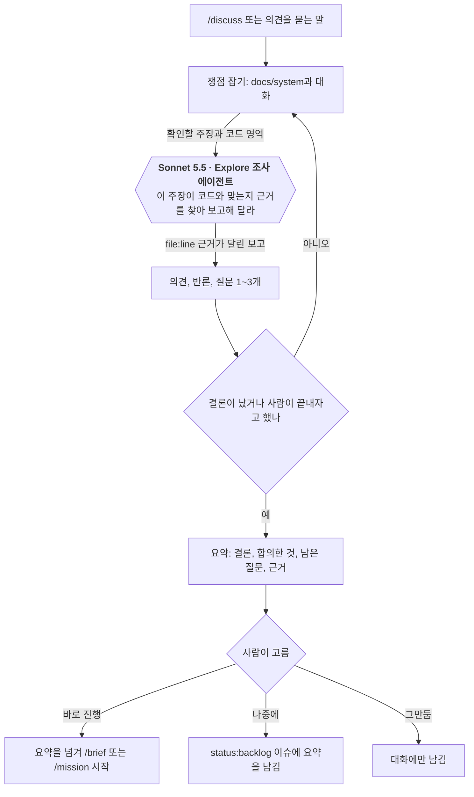
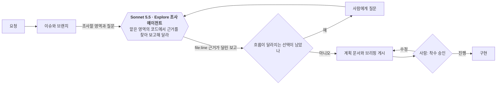
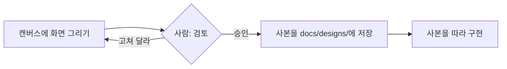
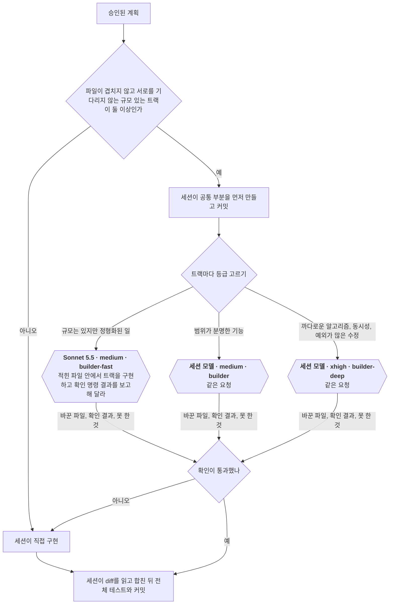
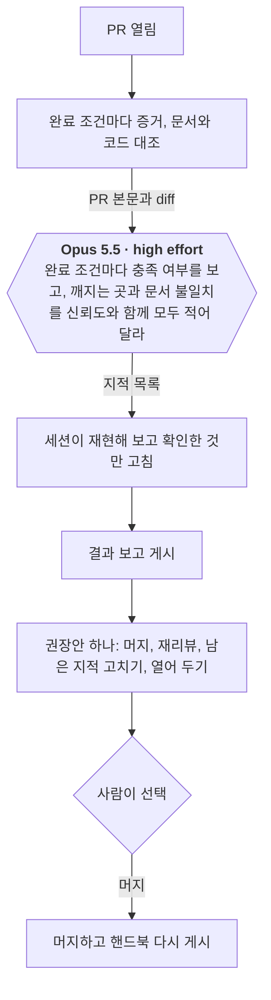
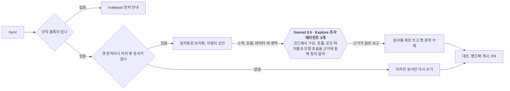

<!-- logbook:system sources="skills/** hooks/** agents/** templates/agents-block.md templates/plan.md" -->
# 주요 흐름

## 흐름 목록

프로젝트마다 한 번 `/rulebook`으로 규칙을 설치한 뒤에는, 모든 변경이 브리핑과 결과 보고를 거치고 프로젝트 문서는 `/sync`로 코드와 맞춥니다. 무엇을 만들지 정하기 전에는 `/discuss`로 토론할 수 있습니다.

| 흐름 | 한 줄 설명 |
|---|---|
| 구현 전 토론 | 아무것도 고치지 않고 아이디어를 따져 본 뒤, 넘기기·backlog·남기지 않기 중 하나를 고릅니다 |
| 구현 전 브리핑 | 조사하고, 흐름이 달라지는 선택은 묻고, 계획을 승인받습니다 |
| 화면 시안 승인 | 화면이 바뀌면 구현 전에 시안을 승인받습니다 |
| 구현과 병렬 트랙 | 이득이 있을 때만 구현을 트랙으로 나눠 builder 에이전트에 동시에 맡깁니다 |
| 구현 후 결과 보고 | 증거, 문서 대조, 별도 리뷰를 거쳐 머지를 고릅니다 |
| 문서 동기화 | 옛 흔적을 정리하고 프로젝트 문서를 코드에 맞춥니다 |

## 구현 전 토론

`/discuss`나 의견만 묻는 말이 들어오면, 에이전트는 파일과 이슈를 건드리지 않은 채 근거를 대며 토론하고, 결론이 나면 사람이 끝맺음을 고릅니다.

- 에이전트는 근거가 있으면 동의하고, 근거가 반대쪽이면 자신 있게 반론합니다. 일부러 반대하지는 않습니다.
- 끝맺음을 고르기 전까지 파일 수정, 커밋, 이슈와 브랜치, Artifact 게시, 플랜 모드, `/debrief`를 쓰지 않습니다. hook으로 막지는 않고 스킬 문구로 지킵니다. 디브리핑 없는 열린 PR이 있는 브랜치에서 토론하면 결과 보고 hook이 턴마다 `/debrief`를 요구하지만, 토론 중에는 한 줄로 알리기만 합니다.
- 토론 중 "해 줘"가 나오면 바로 고치지 않고 끝맺음으로 가서 `/brief`로 넘기기를 권합니다.
- `/brief`는 토론 요약의 결정을 사용자가 정한 것으로 옮기고 남은 질문만 묻습니다. backlog 이슈를 받으면 라벨을 `status:todo`로 바꿉니다.
- 규칙 블록의 "의견을 묻는 말에는 토론으로 답한다" 때문에 명령 없이 의견을 물어도 에이전트가 `/discuss` 스킬을 불러 같은 흐름을 탑니다. 할 일인지 의견인지 애매하면 에이전트가 한 줄로 묻습니다.
- 시작점: `skills/discuss/SKILL.md`, `templates/agents-block.md`

| 모델 호출 | 모델(설정) | 넣는 것 | 요청(프롬프트 요지) | 받는 것과 검사 | 실패하면 |
|---|---|---|---|---|---|
| 토론 | 세션 모델(사용자가 고른 모델) | 사람의 말, 조사 보고, `docs/system/` | 근거를 대며 의견과 반론을 말하고 쟁점을 짚는 질문을 한다(`skills/discuss/SKILL.md`) | 대화 답변. 사람이 읽고 반박합니다 | 해당 없음 |
| 코드 조사 | Sonnet 5.5 Explore 에이전트(스킬 문구의 `model: sonnet`, 다른 하네스는 세션 모델) | 확인할 주장과 코드 영역 | 코드에서 주장이 맞는지 근거를 찾아 `file:line`과 함께 보고한다 | 영역별 보고. 결론에 쓰이는 근거는 세션이 파일을 직접 읽어 다시 확인합니다 | 세션이 직접 읽습니다 |

## 구현 전 브리핑

요청이 들어오면 조사하고, 사용 흐름이 달라지는 선택은 사용자에게 묻고, 계획을 슬라이드로 보고해 착수 승인을 받습니다.

- 사람의 답이 조사 결과, 비용, 위험, 본인이 밝힌 목표와 어긋나 보이면 에이전트가 한 번 걱정과 근거, 더 나은 안을 알립니다. 그대로 가겠다고 하면 따르고 계획 문서에 "알린 우려"로 남깁니다.
- 들어오는 길은 네 가지이고 승인 방법이 다릅니다. 직접 요청과 `/discuss`에서 넘긴 요청은 "진행" 답변, 플랜 모드는 플랜 승인, `/mission`은 출력된 `/goal` 문장의 실행이 승인입니다. `/discuss`에서 넘어오면 토론 요약의 결정은 다시 묻지 않습니다.
- 플랜 모드에서는 hook이 브리핑 블록이 없거나 HTML이 든 플랜을 되돌려 보내고, 문제가 없으면 브라우저로 미리 보여 줍니다.
- 시작점: `skills/brief/SKILL.md`, `skills/mission/SKILL.md`, `hooks/plan-preview.sh`

| 모델 호출 | 모델(설정) | 넣는 것 | 요청(프롬프트 요지) | 받는 것과 검사 | 실패하면 |
|---|---|---|---|---|---|
| 코드 조사 | Sonnet 5.5 Explore 에이전트(`skills/brief/SKILL.md`의 `model: sonnet`, 다른 하네스는 세션 모델) | 조사할 영역과 질문 | 맡은 영역의 코드에서 근거를 찾아 `file:line`과 함께 보고한다 | 영역별 보고서. 프로젝트 문서는 세션이 먼저 읽고, 바뀔 파일도 세션이 직접 읽어 보고를 다시 확인한다 | 보고가 빠지거나 틀려도 세션이 바뀔 파일을 직접 읽는 단계에서 걸린다 |

## 화면 시안 승인

화면을 새로 만들거나 크게 바꾸는 변경은, 계획을 쓰기 전에 시안을 만들어 승인받고 그 사본을 따라 구현합니다.

- Claude Code에서는 `/design`과 같은 Design 캔버스를 쓰고, 캔버스를 쓸 수 없는 곳에서는 HTML 파일로 시안을 만듭니다.
- 플랜 모드와 `/mission`은 읽기 전용 단계라 시안을 올릴 수 없어서, 계획을 승인받은 뒤에 시안을 만듭니다.
- 시작점: `skills/brief/SKILL.md`의 시안 단계

## 구현과 병렬 트랙

승인 뒤 구현은 세션이 직접 하는 것이 기본이고, 독립적이고 규모 있는 트랙이 둘 이상일 때만 나눠서 builder 에이전트에 동시에 맡깁니다.

- 한 줄로 이어진 작업, 몇 번 만에 끝나는 일, 설계 결정, 원인을 모르는 버그, 사람에게 물어야 할 수 있는 일은 나누지 않습니다. 하위 에이전트는 사람에게 질문할 수 없습니다.
- 결과 보고에 트랙마다 맡은 에이전트, 결과, 걸린 시간을 적습니다.
- 시작점: `templates/agents-block.md`의 "구현은 이득이 있을 때만 나눈다", `agents/builder.md`, `agents/builder-fast.md`, `agents/builder-deep.md`

| 모델 호출 | 모델(설정) | 넣는 것 | 요청(프롬프트 요지) | 받는 것과 검사 | 실패하면 |
|---|---|---|---|---|---|
| 병렬 구현 트랙 | `builder-fast`는 Sonnet 5.5와 medium, `builder`는 세션 모델과 medium, `builder-deep`은 세션 모델과 xhigh(각 파일의 `model`, `effort`) | 트랙 목표, 고칠 파일 목록, 먼저 만든 공통 부분, 확인 명령, 계획 문서 경로 | 적힌 파일 안에서만 구현하고 확인 명령을 돌린다. 범위를 넓히지 않고, 모호하면 멈추고 보고한다. 커밋하지 않는다 | 바꾼 파일, 확인 명령 출력, 못 한 것, 스스로 정한 것. 세션이 diff를 읽고 합친 뒤 전체 테스트를 돌린다 | 다시 맡기지 않고 세션이 이어받는다. 이 에이전트가 없는 하네스에서는 세션이 직접 구현한다 |

## 구현 후 결과 보고

PR을 열면 완료 조건마다 증거를 모으고, 프로젝트 문서를 코드와 대조하고, 별도 리뷰어의 검토를 거친 뒤 사람이 다음 단계를 고릅니다.

- PR 본문에 결과 보고 표시(`<!-- logbook:debrief -->`)가 없으면, 대화를 끝낼 때 hook이 한 번 막고 `/debrief`를 실행하라고 알려 줍니다.
- 리뷰는 PR마다 한 번 하고, 리뷰 뒤 고친 내용이 동작을 바꾸면 고친 부분만 한 번 더 봅니다.
- 시작점: `skills/debrief/SKILL.md`, `agents/reviewer.md`, `hooks/debrief-gate.sh`

| 모델 호출 | 모델(설정) | 넣는 것 | 요청(프롬프트 요지) | 받는 것과 검사 | 실패하면 |
|---|---|---|---|---|---|
| 별도 리뷰 | Opus 5.5, high effort(`agents/reviewer.md`의 `model: opus`, `effort: high`) | PR 본문의 완료 조건, diff | 완료 조건마다 충족 여부, 정상 경로에서 깨지는 곳, 프로젝트 문서와 코드의 불일치, 모델 호출 설명 누락, md 안의 HTML을 찾는다. 읽기 도구만 쓴다 | 지적마다 `file:line`, 설명, 신뢰도(0~100), 확인 방법. 세션이 재현해 보고, 확인했거나 80점 이상인 것만 남긴다 | 다른 하네스에서는 세션 모델로 같은 지침을 따른다 |

## 문서 동기화

`/sync`는 기존 프로젝트에서는 옛 흔적을 정리하고 프로젝트 문서를 새로 쓰며, logbook을 쓰던 프로젝트에서는 코드보다 뒤처진 문서만 다시 씁니다.

- 문서마다 첫 줄에 적은 코드 경로를 보고, 그 코드가 문서보다 나중에 바뀌었으면 "뒤처짐"으로 판단합니다.
- 문서에는 코드로 확인한 사실만 남깁니다. 조사 보고는 실마리이고, 세션이 문서를 쓰기 전에 코드에서 다시 확인합니다.
- 시작점: `skills/sync/SKILL.md`, `scripts/legacy_scan.py`, `scripts/system_check.py`

| 모델 호출 | 모델(설정) | 넣는 것 | 요청(프롬프트 요지) | 받는 것과 검사 | 실패하면 |
|---|---|---|---|---|---|
| 코드 조사 | Sonnet 5.5 Explore 에이전트(스킬 문구의 `model: sonnet`, 다른 하네스는 세션 모델) | 조사할 영역(스택, 흐름, 데이터)과 질문 | 코드와 설정을 읽고, 사실마다 파일 경로와 함수 이름을 근거로 달아 보고한다. 모르는 것은 모른다고 적는다 | 영역별 보고서. 세션이 문서에 옮기기 전에 코드에서 다시 확인한다 | 세션이 직접 조사한다 |
