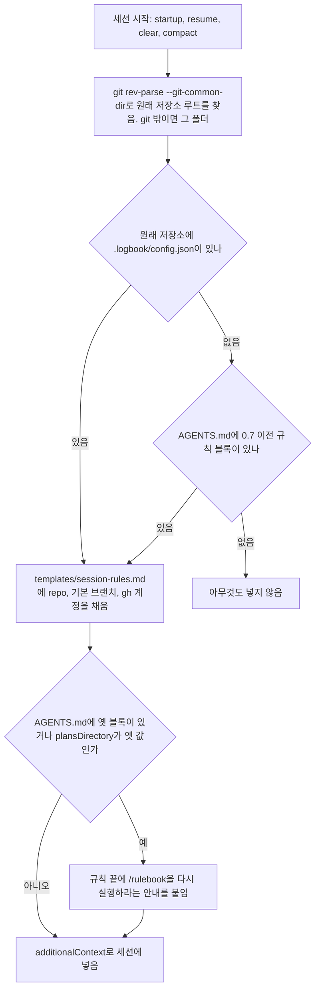
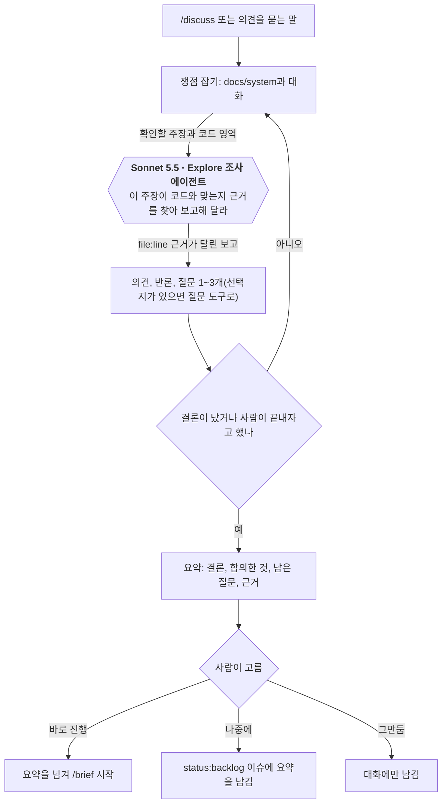
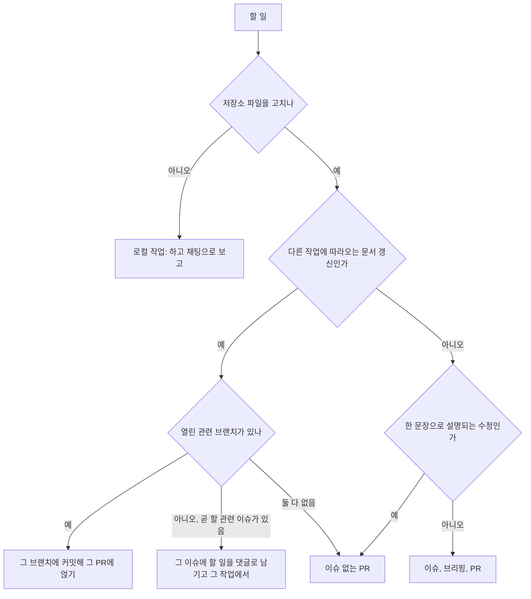
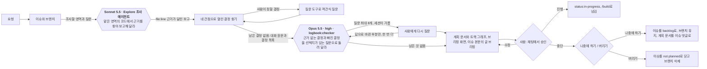
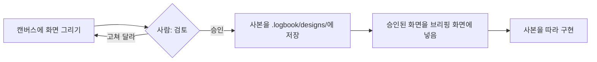
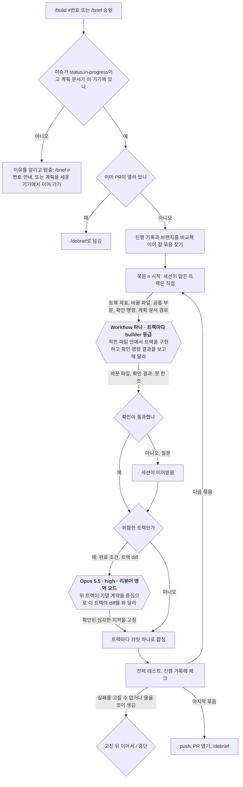
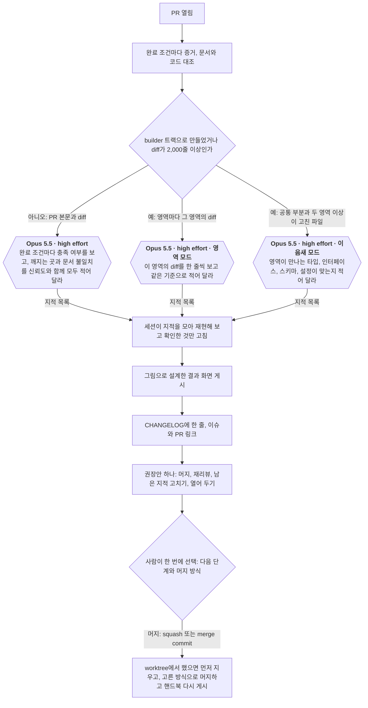
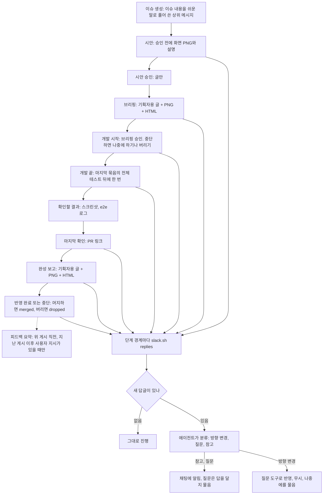
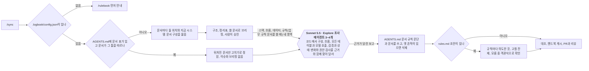

<!-- logbook:system sources="skills/** hooks/** agents/** templates/session-rules.md templates/docs-rules.md scripts/rulebook.sh scripts/worktree.sh templates/plan.md templates/parallel.md templates/questions.md templates/briefing.md templates/planner.md templates/slack.md templates/slack-app.yml scripts/slack.sh scripts/slack.py scripts/slack_config.py scripts/snapshot.py" checked="2026-10-21" -->
# 주요 흐름

## 흐름 목록

clone마다 한 번 `/rulebook`으로 logbook을 켜면 세션마다 작업 규칙이 들어가고, 이슈로 남길 변경은 브리핑과 결과 보고를 거치고, 작은 수정은 이슈 없이 PR만 남기며, 프로젝트 문서는 `/sync`로 코드와 맞춥니다. 무엇을 만들지 정하기 전에는 `/discuss`로 토론할 수 있고, 승인한 계획은 `/build`가 트랙 그래프대로 만들어 PR까지 갑니다. 큰 작업도 이슈 하나, PR 하나입니다.

| 흐름 | 한 줄 설명 |
|---|---|
| logbook 켜기와 세션 규칙 | `/rulebook`이 켜는 표시를 만들고, 세션이 시작될 때마다 hook이 플러그인의 규칙을 넣습니다 |
| 구현 전 토론 | 아무것도 고치지 않고 아이디어를 따져 본 뒤, 넘기기·backlog·남기지 않기 중 하나를 고릅니다 |
| 이슈로 남길지 정하기 | 다른 개발자가 알아야 하거나 꼭 남길 작업만 이슈가 되고, 나머지는 PR만 열거나 관련 PR에 얹거나 채팅으로 보고합니다 |
| 구현 전 브리핑 | 조사하고, 사람이 정할 결정을 객관식으로 묻고, 독립 점검을 거쳐 트랙 그래프까지 계획한 뒤 채팅에서 승인받습니다 |
| 화면 시안 승인 | 화면이 바뀌면 구현 전에 시안을 승인받습니다. Slack을 켰으면 승인 전에 시안부터 올려 의견을 받습니다 |
| /build로 구현 | 트랙 그래프대로 묶음마다 builder 트랙을 Workflow 하나로 동시에 돌리고, 위험한 트랙은 합치기 전에 리뷰하며, 묶음마다 전체 테스트를 돌린 뒤 PR로 넘깁니다 |
| 구현 후 결과 보고 | 증거, 문서 대조, 별도 리뷰(큰 PR은 영역별로 나눠서), 결과 화면을 거쳐 다음 단계와 머지 방식을 고릅니다 |
| Slack 쓰레드 | 이슈마다 쓰레드 하나에 진행 상황, 브리핑, 결과 화면을 올리고, 쓰레드에 달린 답글은 단계마다 읽어 사용자에게 넘깁니다. AGENTS.md의 채널 줄이나 환경 변수 `LOGBOOK_SLACK_CHANNEL`로 채널이 정해진 저장소에서만 동작합니다 |
| 문서 동기화 | 문서 구조를 정하고, 옛 흔적을 정리하고, 프로젝트 문서를 코드에 맞춥니다. 도메인 규칙이 있으면 업무 규칙 문서 초안을 쓰고 확인받습니다 |

## logbook 켜기와 세션 규칙

`/rulebook`은 clone마다 한 번 logbook을 켜고, 그 뒤로는 세션이 시작될 때마다 hook이 플러그인의 최신 규칙을 넣습니다. 규칙이 저장소에 없으므로 플러그인을 올려도 프로젝트에서 할 일이 없습니다.

- `/rulebook`은 `.logbook/config.json`(repo, 기본 브랜치, gh 계정), `.gitignore`의 `.logbook/`, 이슈 라벨 네 개(`status:*`), `plansDirectory`(플랜 모드의 계획 파일이 저장되는 폴더)를 준비합니다. `plansDirectory`는 git이 무시하는 `.logbook/plans`입니다. 다시 실행할 때 인자로 받지 않은 값은 기존 `config.json`의 값을 이어받습니다. AGENTS.md는 0.7 이전 규칙 블록이 있을 때만 고칩니다. 블록 자리에 그 안의 문서 규칙을 일반 문단(`templates/docs-rules.md`)으로 옮겨 씁니다.
- `.logbook/`은 git에서 제외되어 clone에 따라오지 않습니다. 새로 clone한 저장소는 `/rulebook`을 실행하기 전까지 규칙이 들어가지 않고, 경고도 없습니다. worktree는 원래 저장소의 설정을 읽으므로 따로 켤 필요가 없습니다. worktree에서 `/rulebook`을 실행하면 설정을 원래 저장소에 쓰고, 원래 저장소의 `.git/info/exclude`에 `.logbook/`을 넣습니다.
- 플랜 검사와 결과 보고 hook도 같은 판정(`hooks/lib.sh`)으로 logbook 저장소인지 정합니다. git 밖 폴더는 세션 규칙과 플랜 검사만 그 폴더 자체를 보고(하위 폴더는 보지 않습니다), 결과 보고 hook은 PR이 없으므로 동작하지 않습니다.
- hook 출력은 Claude Code가 한 번에 10,000자까지 그대로 넣습니다. 규칙은 약 5,900자이고, `tests/run.sh`가 한도를 넘지 않는지 확인합니다.
- Slack 쓰레드를 쓰려면 `/rulebook --slack-channel <ID>`를 실행합니다. AGENTS.md에 Slack 채널 줄을 한 줄 씁니다. 채널 줄 없이 환경 변수 `LOGBOOK_SLACK_CHANNEL`만 두면 모든 프로젝트가 그 채널을 씁니다. 자세한 내용은 "Slack 쓰레드"에 있습니다.
- 시작점: `hooks/session-rules.sh`, `hooks/lib.sh`, `scripts/rulebook.sh`, `skills/rulebook/SKILL.md`

## 구현 전 토론

`/discuss`나 의견만 묻는 말이 들어오면, 에이전트는 파일과 이슈를 건드리지 않은 채 근거를 대며 토론하고, 결론이 나면 사람이 끝맺음을 고릅니다.

- 에이전트는 근거가 있으면 동의하고, 근거가 반대쪽이면 자신 있게 반론합니다. 일부러 반대하지는 않습니다.
- 끝맺음을 고르기 전까지 파일 수정, 커밋, 이슈와 브랜치, Artifact 게시, 플랜 모드, `/debrief`를 쓰지 않습니다. hook으로 막지는 않고 스킬 문구로 지킵니다. 디브리핑 없는 열린 PR이 있는 브랜치에서 토론하면 결과 보고 hook이 커밋마다 한 번 `/debrief`를 요구하지만, 토론 중에는 한 줄로 알리기만 합니다.
- 질문은 선택지를 나열할 수 있으면 질문 도구로 객관식으로 묻고, 선택지마다 근거를 메시지에 먼저 적습니다. 선택지를 나열할 수 없을 때만 글로 묻습니다(`templates/questions.md`의 "How to ask").
- 토론 중 "해 줘"가 나오면 바로 고치지 않고 끝맺음으로 가서 `/brief`로 넘기기를 권합니다.
- `/brief`는 토론 요약의 결정을 사용자가 정한 것으로 옮기고 남은 질문만 묻습니다. backlog 이슈를 받으면 라벨을 `status:todo`로 바꿉니다.
- logbook 규칙의 "의견을 묻는 말에는 토론으로 답한다" 때문에 명령 없이 의견을 물어도 에이전트가 `/discuss` 스킬을 불러 같은 흐름을 탑니다. 할 일인지 의견인지 애매하면 에이전트가 한 줄로 묻습니다.
- Slack 쓰레드를 켠 저장소에서 backlog로 끝맺으면 이슈를 만들면서 쓰레드의 상위 메시지도 올립니다. 자세한 내용은 "Slack 쓰레드"에 있습니다.
- 시작점: `skills/discuss/SKILL.md`, `templates/session-rules.md`

| 모델 호출 | 모델(설정) | 넣는 것 | 요청(프롬프트 요지) | 받는 것과 검사 | 실패하면 |
|---|---|---|---|---|---|
| 토론 | 세션 모델(사용자가 고른 모델) | 사람의 말, 조사 보고, `docs/system/` | 근거를 대며 의견과 반론을 말하고 쟁점을 짚는 질문을 한다(`skills/discuss/SKILL.md`) | 대화 답변. 사람이 읽고 반박합니다 | 해당 없음 |
| 코드 조사 | Sonnet 5.5 Explore 에이전트(서브에이전트나 Workflow, `templates/parallel.md`의 모델 표. 다른 하네스는 세션 모델) | 확인할 주장과 코드 영역 | 코드에서 주장이 맞는지 근거를 찾아 `file:line`과 함께 보고한다 | 영역별 보고. 결론에 쓰이는 근거는 세션이 파일을 직접 읽어 다시 확인합니다 | 세션이 직접 읽습니다 |

## 이슈로 남길지 정하기

할 일이 들어오면 에이전트는 먼저 이 작업을 이슈로 남길지 정합니다. 다른 개발자가 알아야 하거나 꼭 남겨야 하는 작업(기능, 버그 수정, 설계 변경, 나중에 할 일)만 이슈와 브리핑을 거칩니다. 한 문장으로 설명되는 작은 수정은 버그 수정이라도 이슈 없이 PR만 엽니다.

- 로컬 작업은 도구 설치, 로컬 서비스 정지, 그 기기의 설정 파일처럼 저장소를 고치지 않는 일입니다. 다른 개발자도 같은 준비를 해야 하면 그 내용만 `docs/system/stack.md`에 남기고, 이 갱신은 따라오는 문서 갱신으로 처리합니다.
- 이슈 없는 PR은 `<type>/<slug>` 브랜치에서 엽니다. 기본 브랜치에 직접 커밋하지 않는 규칙은 그대로입니다. 계획 문서가 없는 PR은 `/debrief`가 결과 화면 없이 PR 본문에 증거를 남기고, 한 문장 수정이 아니면 독립 리뷰는 그대로 합니다.
- 곧 할 이슈로 미룬 문서 갱신은 그 이슈의 댓글에 남습니다. 그 이슈로 `/brief`나 플랜 모드를 시작하면 댓글을 읽어 같은 변경에 넣습니다.
- 어느 쪽인지 애매하면 에이전트가 작업 전에 한 줄로 묻습니다.
- 시작점: `templates/session-rules.md`의 "이슈는 남길 일에만 만든다", `skills/brief/SKILL.md`의 건너뛰는 경우

## 구현 전 브리핑

요청이 들어오면 조사하고, 사람이 정할 결정을 모두 객관식으로 묻고, 독립 점검으로 짐작한 결정을 한 번 더 걸러 낸 뒤 계획과 브리핑 화면을 만들어 채팅에서 승인받습니다. 승인하면 다시 묻지 않고 `/build`로 넘깁니다.

- 사람이 정할 결정은 쓰는 방식(명령, 단계, 승인 시점, 파일과 데이터), 도메인 규칙과 예외 상황, 득실이 있는 기술 선택입니다. 구조, 동작, 기술, 계약 네 관점으로 바뀌는 대상과 그 짝마다 찾습니다. 요청, 대화, 코드, 문서로 이미 정해진 것과 사람이 신경 쓰지 않을 조정값은 에이전트가 정하고 브리핑에 표시합니다. 요청과 코드와 문서가 서로 다르면 고르지 않고 묻습니다.
- 질문은 질문 도구로 한 번에 1~4개, 선택지 2~4개에 권장안을 먼저 둡니다. 도메인 질문에는 "다른 생각이 있다"를 선택지로 넣습니다. 질문 도구가 없거나 실패하면 번호를 붙인 글로 묻습니다(`templates/questions.md`).
- 독립 점검은 질문을 마치고 계획 문서를 쓰기 전에 한 번, 그 답으로 바뀐 부분에 한 번 더 돌립니다. 대화를 볼 수 없는 에이전트이므로 사용자 메시지와 질문별 답을 원문 그대로 넘깁니다. 브리핑이 없는 작은 수정에는 돌리지 않습니다.
- 사람의 답이 조사 결과, 비용, 위험, 본인이 밝힌 목표와 어긋나 보이면 에이전트가 한 번 걱정과 근거, 더 나은 안을 알립니다. 그대로 가겠다고 하면 따르고 계획 문서와 PR 본문에 "알린 우려"로 남깁니다.
- 계획 문서는 원래 checkout(git worktree가 아닌 처음 clone한 폴더)의 `.logbook/plans/<번호>-<slug>.md`에 두고 커밋하지 않습니다. 브리핑 블록은 이슈 본문의 글 브리핑과 승인 메시지의 원본입니다. `## 상세`에는 트랙 그래프(묶음, 트랙, 맡을 에이전트, 바꿀 파일, 기다리는 트랙, 위험, 확인 명령)를 쓰고, 사람에게 묻지 않으며 브리핑 화면에도 넣지 않습니다.
- 브리핑 화면은 `templates/briefing.md`대로 이슈마다 그림으로 설계하고, 버튼과 움직임은 꼭 필요할 때만 씁니다. 결론과 요청, 무엇이 바뀌나, 주요 로직 흐름, 결정(사람과 에이전트), 위험과 판단 필요, 완료 조건이 꼭 들어가고, DB 변경과 승인된 화면 시안은 해당될 때 넣습니다. Claude Code에서는 Artifact로 게시하고, 게시할 수 없는 곳에서는 로컬 HTML 파일을 엽니다. 승인한 뒤에는 고치지 않습니다.
- 이슈 본문은 글 브리핑(요약, 바뀌는 것, 주요 결정, 위험, 완료 조건)과 화면 링크로 바꿉니다. 다른 사람이 쓴 본문이면 그 글을 끝에 `## 원래 요청`으로 남깁니다.
- 승인은 채팅에서 받습니다. 요약 한 문장, 동작이나 비용을 바꾸는 에이전트의 결정, 위험과 판단 필요, 완료 조건 수, 화면 링크를 붙이고 진행 / 수정 / 중단을 질문 도구로 묻습니다.
- 정한 도메인 규칙은 업무 규칙 문서(`rules.md`)에 남깁니다. 프로젝트에 이 문서가 없고 이번 변경이 첫 도메인 규칙을 정하면 `templates/system/rules.md`로 만듭니다.
- 들어오는 길은 세 가지입니다. 직접 요청과 `/discuss`에서 넘긴 요청은 채팅의 "진행"이 착수 승인입니다. 플랜 모드는 질문과 독립 점검, 트랙 그래프까지 플랜 안에서 마치고, 플랜을 승인한 뒤 브리핑 화면과 이슈 본문을 만들어 채팅에서 한 번 더 승인받습니다. `/discuss`에서 넘어오면 토론 요약의 결정은 다시 묻지 않습니다.
- 플랜 모드에서는 hook이 브리핑 블록이 없거나 HTML이 든 플랜을 되돌려 보내고, 미리보기 창은 띄우지 않습니다. 렌더러를 실행하지 못해 HTML 검사를 못 하면(python3가 없는 경우 등) 경고 메시지를 냅니다. 승인 직후에는 남은 절차를 알려 줍니다. 플랜 파일은 작업 트리의 `.logbook/plans`에 저장되고, 승인되면 원래 checkout의 `.logbook/plans/<번호>-<slug>.md`로 옮깁니다.
- 이미 `status:in-progress`인 이슈로 `/brief`를 부르면 승인된 계획이므로 `/build #<번호>`로 넘깁니다.
- 중단하면 나중에 할지 버릴지를 묻습니다. 나중에 하기를 고르면 계획 문서 전문을 첫 줄이 `계획 문서`인 이슈 댓글로 남깁니다. `/brief #<번호>`로 다시 시작하면 로컬 계획 문서가 있으면 그것을, 없으면 그 댓글을 읽어 이어서 씁니다.
- 조사 에이전트는 영역이 둘이면 서브에이전트로, Workflow를 쓸 수 있고 영역이 셋 이상이면 Workflow로 띄웁니다(`templates/parallel.md`). `/discuss`와 `/sync`의 조사도 같습니다.
- Slack 쓰레드를 켠 저장소라면 이슈 생성, 시안(승인을 묻기 전과 고칠 때마다), 시안 승인, 브리핑, 브리핑 승인(또는 중단 결과)을 쓰레드에 올리고, 승인을 묻기 전에 새 답글을 읽습니다. 자세한 내용은 "Slack 쓰레드"에 있습니다.
- 시작점: `skills/brief/SKILL.md`, `templates/questions.md`, `templates/briefing.md`, `agents/checker.md`, `hooks/plan-preview.sh`

| 모델 호출 | 모델(설정) | 넣는 것 | 요청(프롬프트 요지) | 받는 것과 검사 | 실패하면 |
|---|---|---|---|---|---|
| 코드 조사 | Sonnet 5.5 Explore 에이전트(서브에이전트는 `model: sonnet`, Workflow는 `agentType: 'Explore', model: 'sonnet'`, `templates/parallel.md`. 다른 하네스는 세션 모델) | 조사할 영역과 질문 | 맡은 영역의 코드에서 근거를 찾아 `file:line`과 함께 보고한다 | 영역별 보고서. 프로젝트 문서는 세션이 먼저 읽고, 바뀔 파일도 세션이 직접 읽어 보고를 다시 확인한다 | 보고가 빠지거나 틀려도 세션이 바뀔 파일을 직접 읽는 단계에서 걸린다 |
| 독립 점검 | Opus 5.5, high effort(`agents/checker.md`의 `model: opus`, `effort: high`. 읽기 도구만 씀) | 사용자 메시지와 질문별 답 원문, 사람이 정한 것·에이전트가 정한 것·조정값으로 나눈 결정 목록 | 대화에 근거 없는 결정과 아무도 적지 않은 결정을 네 관점으로 찾아, 선택지가 있는 질문으로 돌려 달라. 답은 직접 정하지 않는다 | 최대 8개 항목(결정, 근거가 없는 이유, 짐작하면 생기는 문제, 질문과 선택지). 세션이 대화나 코드로 정해진 항목을 거르고 몇 개를 걸렀는지 밝힌 뒤 나머지를 묻는다 | 세션이 네 관점으로 직접 한 번 더 훑고, 독립 점검을 하지 못했다고 브리핑에 적는다 |

## 화면 시안 승인

화면을 새로 만들거나 크게 바꾸는 변경은, 계획을 쓰기 전에 시안을 만들어 승인받고 그 사본을 따라 구현합니다.

- Claude Code에서는 `/design`과 같은 Design 캔버스를 쓰고, 캔버스를 쓸 수 없는 곳에서는 HTML 파일로 시안을 만듭니다.
- 플랜 모드는 읽기 전용 단계라 시안을 올릴 수 없어서, 계획을 승인받은 뒤에 시안을 만듭니다.
- 승인본의 사본은 원래 checkout의 `.logbook/designs/<번호>-<slug>/`에 두고 커밋하지 않습니다. 승인된 화면은 링크만 걸지 않고 브리핑 화면 안에 넣고, 캔버스 링크는 PR 본문에 남깁니다.
- 시작점: `skills/brief/SKILL.md`의 시안 단계

## /build로 구현

`/build`는 승인된 계획 문서의 트랙 그래프대로 묶음 0의 공통 부분을 세션이 만든 뒤, 묶음마다 builder 트랙을 Workflow 하나로 동시에 돌리고 합칠 때마다 전체 테스트를 돌립니다. 마지막 묶음 뒤에 PR을 열고 `/debrief`로 넘깁니다.

- 트랙 그래프는 `/brief`가 계획 문서 `## 상세`에 씁니다. 같은 묶음의 트랙끼리는 파일이 겹치지 않습니다. 묶음은 세션이 리뷰하고 합치는 단위라 크게 잡아서, 공통 부분 다음에 나머지를 한 묶음으로 두는 것이 기본입니다. 앞 결과를 리뷰하고 합쳐야만 뒤 트랙을 시작할 수 있을 때만 묶음을 더 나누고, 그 이유를 그래프에 적습니다. 묶음 0은 공통 부분(타입, 인터페이스, 설정)이고 세션이 만듭니다. 묶음 0도 다른 묶음과 같은 단계(위험하면 리뷰, 트랙마다 커밋, 전체 테스트, 진행 기록)를 거칩니다.
- 맡을 에이전트는 그래프에 적힌 대로입니다. 규모는 있지만 정형화된 트랙은 builder-fast, 범위가 분명한 기능은 builder, 까다로운 알고리즘이나 동시성, 예외가 많은 수정은 builder-deep이 맡습니다. 설계 판단이 많거나 몇 번 만에 끝나거나 사람에게 물어야 할 수 있는 일은 세션이 직접 합니다. 하위 에이전트는 사람에게 질문할 수 없습니다.
- builder 트랙이 있는 묶음은 트랙 수와 상관없이 Workflow로 돌립니다. 트랙이 Workflow 크기 설정(기본 10개 미만)을 넘으면 Workflow 여러 개로 나눠 차례로 돌리고, 그래도 한 묶음입니다. 합치기, 위험한 트랙의 리뷰, 전체 테스트는 판단이나 질문이 필요할 수 있어 묶음 사이에 세션이 합니다. Workflow를 쓸 수 없으면 한 메시지에서 서브에이전트로 띄우고, 그것도 없으면 세션이 직접 구현합니다.
- 그래프에 위험으로 표시한 트랙(까다로운 로직, 다른 트랙이 기대는 계약, 예외가 많은 수정)은 합치기 전에 리뷰어가 영역 모드로 봅니다. PR 본문 대신 계획 문서의 완료 조건, 그 트랙의 diff와 diff 통계를 넘깁니다.
- 트랙마다 커밋 하나로 합칩니다. 그래서 merge commit으로 머지하면 트랙 하나만 되돌릴 수 있습니다.
- 트랙은 같은 작업 트리에서 돌리거나 트랙마다 git worktree(한 저장소를 여러 폴더에 동시에 checkout하는 git 기능)를 줍니다. 같은 작업 트리에서는 트랙의 확인 명령이 그 트랙의 파일만 검사하고 builder는 커밋하지 않습니다. worktree를 받은 트랙은 그 안에서 전체 테스트를 돌리고 트랙 브랜치에 커밋하며, 세션이 그 브랜치를 합칩니다.
- worktree는 `scripts/worktree.sh add <브랜치> <기준 브랜치>`가 원래 checkout의 `.logbook/worktrees/`에 브랜치 이름의 `/`를 `-`로 바꾼 폴더로 만들고(`worktree.sh path <브랜치>`가 경로를 알려 줍니다), 원래 checkout의 git이 무시하는 `.env`, `.env.*` 파일을 링크합니다. 의존성 설치는 세션이 `docs/system/stack.md`를 보고 합니다. Claude Code의 `isolation: worktree`는 기본 브랜치에서 worktree를 만들어 공통 부분이 빠지므로 쓰지 않습니다.
- 합친 트랙의 worktree는 원래 checkout에서 `worktree.sh remove <브랜치> --delete-branch`로 바로 지웁니다. 합치지 않은 커밋이 남은 브랜치는 지우지 않고 종료 코드 4로 끝나며, 세션은 강제로 지우지 않고 보고합니다. 세션이 이어받은 트랙도 합친 뒤 같이 지웁니다. 이미 있는 브랜치는 기준 브랜치에서 다시 자르지 않고 그대로 쓰므로, 두 번째 병렬 실행에는 새 트랙 이름을 씁니다. 커밋하지 않은 변경이 남아 있으면 스크립트가 지우지 않고(종료 코드 3), 세션이 멈추고 경로를 보고합니다.
- 그래프와 실제가 다르면(예상하지 못한 공통 파일, 생각보다 작은 트랙, 새로 생긴 의존) 그래프를 고치고 무엇을 왜 바꿨는지 계획 문서의 결정 기록과 PR 본문에 남깁니다.
- 멈추면 묶음, 이유, 이어 가려면 필요한 것을 보고하고 "고친 뒤 이어서 / 중단"을 질문 도구로 묻습니다. 중단하면 계획 문서, 브랜치, 커밋을 그대로 두고 이슈는 `status:in-progress`로 남깁니다. 나중에 `/build #<번호>`로 이어 갑니다. 끊긴 묶음이 남긴 것은 먼저 이어받습니다. 같은 폴더 트랙의 커밋하지 않은 파일은 그래프의 파일 목록과 맞춰 마무리하고, 트랙 worktree는 그 커밋을 합치거나 이어받습니다. 이어받은 트랙도 묶음의 합치기 단계에서 위험 리뷰와 트랙별 커밋을 거칩니다. 트랙 그래프가 없는 0.12 이전 계획은 세션이 한 묶음으로 만듭니다.
- 진행 상황은 이 기기의 계획 문서에만 남습니다. 계획 문서가 없는 기기에서는 이어 가지 않고, 계획을 세운 기기에서 이어 가거나 이슈를 `status:todo`로 돌려 다시 계획하라고 알립니다.
- 구현 중에는 테스트를 약하게 하거나 지우지 않고, 계획에 없는 스키마 변경과 데이터 삭제는 멈추고 묻습니다. `docs/system/`이 설명하는 내용이 바뀌면 같은 PR에서 고치고, 도메인 규칙을 정하거나 바꾸면 `rules.md`도 고칩니다.
- PR 본문에는 요약, 주요 결정(사람이 정한 것과 버린 대안, 알린 우려, 에이전트가 정한 것), 시안 링크, 완료 조건, 트랙마다 한 줄(묶음, 에이전트, 파일, Workflow와 worktree 여부), 그래프를 바꾼 이유를 적습니다. 계획 문서는 로컬에만 있기 때문입니다.
- Slack 쓰레드를 켠 저장소라면 마지막 묶음의 전체 테스트가 끝난 뒤 개발 끝을 한 번만 쉬운 말로(묶음마다 올리지 않습니다), 사람이 눈으로 확인할 결과와 PR 링크를 쓰레드에 올립니다. 답글은 묶음마다 읽습니다. 자세한 내용은 "Slack 쓰레드"에 있습니다.
- 시작점: `skills/build/SKILL.md`, `templates/parallel.md`의 "Track graph", `templates/session-rules.md`의 "독립 트랙은 나눠서 동시에 만든다", `agents/builder.md`, `agents/builder-fast.md`, `agents/builder-deep.md`

| 모델 호출 | 모델(설정) | 넣는 것 | 요청(프롬프트 요지) | 받는 것과 검사 | 실패하면 |
|---|---|---|---|---|---|
| 병렬 구현 트랙 | `builder-fast`는 Sonnet 5.5와 medium, `builder`는 세션 모델과 medium, `builder-deep`은 세션 모델과 high(각 파일의 `model`, `effort`. Workflow는 `agent()`의 `agentType`, `model`, `effort`에 같은 값을 적습니다) | 트랙 목표, 고칠 파일 목록, 먼저 만든 공통 부분, 확인 명령, 계획 문서 경로, worktree를 받았으면 그 경로 | 적힌 파일 안에서만 구현하고 확인 명령을 돌린다. 범위를 넓히지 않고, 모호하면 멈추고 보고한다. 같은 폴더면 커밋하지 않고, worktree면 그 안에서만 일하고 자기 브랜치에 커밋한다(push하지 않는다) | 정해진 형식(schema)의 결과: 바꾼 파일, worktree면 브랜치와 커밋, 확인 명령 출력, 통과 여부, 못 한 것, 스스로 정한 것. 세션이 diff를 읽고 합친 뒤 전체 테스트를 돌린다 | 다시 맡기지 않고 세션이 이어받는다. 이 에이전트가 없는 하네스에서는 세션이 직접 구현한다 |
| 위험한 트랙 리뷰 | Opus 5.5, high effort(`agents/reviewer.md`의 Area mode) | 계획 문서의 완료 조건(PR 본문 대신), 트랙의 diff, diff 통계 | 이 트랙의 diff를 한 줄씩 보고, 뒤 트랙이 기댈 계약을 중심으로 깨지는 곳을 신뢰도와 함께 적는다 | 지적마다 `file:line`, 신뢰도, 확인 방법. 세션이 재현해 보고 확인된 심각한 지적을 고친 뒤 합친다 | 다른 하네스에서는 세션 모델로 같은 지침을 따른다 |

## 구현 후 결과 보고

PR을 열면 완료 조건마다 증거를 모으고, 프로젝트 문서를 코드와 대조하고, 별도 리뷰어의 검토를 거쳐 결과 화면을 올린 뒤 사람이 다음 단계와 머지 방식을 고릅니다.

- PR 본문에 결과 보고 표시(`<!-- logbook:debrief -->`)가 없으면, 대화를 끝낼 때 hook이 막고 `/debrief`를 실행하라고 알려 줍니다. 확인한 커밋을 기록해 두어 같은 커밋에서는 한 번만 막고, 새 커밋이 생기면 다시 한 번 막습니다.
- 리뷰는 PR마다 한 번 하고, 리뷰 뒤 고친 내용이 동작을 바꾸면 고친 부분만 한 번 더 봅니다.
- builder 트랙으로 만들었거나 바뀐 줄이 2,000줄 이상(lock 파일과 생성 파일 제외)인 PR은 첫 리뷰를 나눕니다. 트랙마다, 트랙이 없으면 폴더나 모듈 단위로 영역 리뷰어를 두고(트랙 밖에서 세션이 고친 파일은 한 영역으로 묶습니다), 영역이 만나는 곳을 보는 이음새 리뷰어를 하나 더 둡니다. 트랙으로 만들었는지는 PR 본문의 트랙 목록으로 압니다. 나눠 보는 리뷰는 리뷰어를 Workflow로 동시에 띄우고, Workflow를 쓸 수 없으면 서브에이전트로 띄웁니다(`templates/parallel.md`의 "Review split"). 고친 부분만 보는 두 번째 리뷰는 리뷰어 하나가 봅니다.
- 문서 대조 범위는 PR의 실제 base입니다(`system-check.sh --range origin/<PR base>...HEAD`).
- 결과 블록은 로컬 계획 문서에 채우고 커밋하지 않습니다. PR 본문에는 계획과 달라진 점, 완료 조건별 증거를 적습니다.
- CHANGELOG에는 쓰는 사람이 알아챌 변경만 한 줄 적고 이슈와 PR을 링크합니다. 위치와 형식(버전별, 날짜별)은 AGENTS.md 문서 표나 파일이 이미 쓰는 형식을 따르고, 파일이 없으면 루트에 Keep a Changelog 형식으로 만듭니다. PR 번호가 PR을 연 뒤에 정해지므로 `/debrief`가 씁니다. 테스트나 내부 정리만 한 PR은 적지 않습니다.
- 결과 화면은 `templates/briefing.md`대로 이 변경에 맞게 그림으로 설계합니다. 계획과 결과의 비교, 계획과 달라진 점과 이유, 완료 조건별 증거, 리뷰 회차, 트랙을 보여 주고, `.logbook/briefs/<번호>-debrief.html`에 쓴 뒤 Claude Code에서는 Artifact로 게시합니다. 계획 문서가 없는 PR은 결과 화면을 만들지 않습니다.
- 다음 단계(머지, 재리뷰, 남은 지적 고치기, PR 열어 두기)와 머지 방식을 질문 도구 한 번에 두 질문으로 묻습니다. 트랙이 둘 이상인 PR은 트랙마다 커밋이 남는 merge commit을, 아니면 squash를 권합니다. 저장소가 고른 방식을 막아 두었으면 알리고 다른 방식을 제안합니다.
- 계획의 주요 결정이 도메인 규칙을 정하거나 바꿨으면 `rules.md`에 적혔는지 확인하고, 없으면 이 PR에서 고칩니다.
- Slack 쓰레드를 켠 저장소라면 결과 화면을 만든 뒤 결과 요약과 화면을, 머지하면 반영 완료를 쓰레드에 올리고, 머지 전에 새 답글을 읽습니다. 자세한 내용은 "Slack 쓰레드"에 있습니다.
- 시작점: `skills/debrief/SKILL.md`, `templates/briefing.md`, `agents/reviewer.md`, `templates/parallel.md`의 "Review split", `hooks/debrief-gate.sh`

| 모델 호출 | 모델(설정) | 넣는 것 | 요청(프롬프트 요지) | 받는 것과 검사 | 실패하면 |
|---|---|---|---|---|---|
| 별도 리뷰 | Opus 5.5, high effort(`agents/reviewer.md`의 `model: opus`, `effort: high`) | PR 본문의 완료 조건, diff | 완료 조건마다 충족 여부, 정상 경로에서 깨지는 곳, 프로젝트 문서와 코드의 불일치, 모델 호출 설명 누락, md 안의 HTML을 찾는다. 읽기 도구만 쓴다 | 지적마다 `file:line`, 설명, 신뢰도(0~100), 확인 방법. 세션이 재현해 보고, 확인했거나 80점 이상인 것만 남긴다 | 다른 하네스에서는 세션 모델로 같은 지침을 따른다 |
| 영역 리뷰 | Opus 5.5, high effort(같은 에이전트의 Area mode) | PR 본문, 전체 diff 통계, 맡은 영역 파일의 diff | 자기 영역의 diff를 한 줄씩 보고, 영역 밖은 자기 영역 코드가 깨뜨린 것만 적는다 | 지적과 자기 영역이 닿는 완료 조건마다 한 줄. 세션이 모든 리뷰어의 지적을 모아 중복을 지우고 재현해 거릅니다 | 다른 하네스에서는 세션 모델로 같은 지침을 따릅니다 |
| 이음새 리뷰 | Opus 5.5, high effort(같은 에이전트의 Seam mode) | PR 본문, 전체 diff 통계, 영역과 파일 목록, 공통 부분의 diff, 두 영역 이상이 고친 파일의 diff | 한 영역이 만들거나 바꾼 타입, 인터페이스, 스키마, 설정을 다른 영역이 맞게 쓰는지, 여러 영역에 걸친 완료 조건을 본다 | 지적과 완료 조건마다 한 줄 | 다른 하네스에서는 세션 모델로 같은 지침을 따릅니다 |

## Slack 쓰레드

저장소 AGENTS.md에 Slack 채널 줄이 있거나 환경 변수 `LOGBOOK_SLACK_CHANNEL`이 있으면(채널 줄이 앞섭니다), logbook은 이슈마다 Slack 쓰레드(메시지 하나에 답글이 이어지는 대화)를 하나 만들어 진행 상황을 올리고, 사람이 단 답글은 단계가 바뀔 때 읽어 사용자에게 넘깁니다. 둘 다 없으면 이 흐름 없이 동작합니다. 언제 무엇을 올리고 답글을 어떻게 다루는지는 `templates/slack.md`가 스킬에 알려 줍니다.

- 기획자는 GitHub에 들어갈 수 없으므로, 상위 메시지에는 이슈 내용(무엇을, 왜, 누구에게 좋은지)을 쉬운 말로 풀어 쓰고 GitHub 링크는 끝에 개발자용 한 줄로 둡니다. 이슈 내용이 바뀌면 `slack.sh thread <이슈> --text <파일>`을 다시 실행해 상위 메시지를 고칩니다(`chat.update`).
- 게시는 `scripts/slack.sh`가 합니다. 이슈 댓글에 남긴 쓰레드 표시(`<!-- logbook:slack ... -->`)로 쓰레드를 찾고, 없으면 상위 메시지를 올린 뒤 표시를 남깁니다. 표시를 남기지 못하면 방금 올린 상위 메시지를 지워 쓰레드가 둘로 생기지 않게 합니다. 표시에는 읽은 위치(`read`)와 단계별 화면 해시도 들어갑니다.
- 스크립트는 모든 글을 Slack Block Kit으로 바꿉니다. 단계의 아이콘과 이름을 단 큰 제목, 진행 줄(계획 → 만들기 → 확인 → 반영), 구분선, 본문, 작고 회색인 바닥글 순서입니다. `개발자용:`으로 시작하는 줄은 바닥글로 옮기고, 브리핑과 완성 보고의 첨부는 개발자용이라는 안내를 스크립트가 바닥글에 붙입니다. Slack이 블록을 거부하면(`invalid_blocks`) 블록 메시지를 먼저 다시 시도하고, 그래도 안 되면 파일만 올립니다.
- 진행 줄은 상위 메시지와 모든 게시에 나옵니다. 지금 단계는 이슈 댓글 표시에 `phase=`로 저장합니다. 단계가 바뀔 때만 상위 메시지를 다시 쓰고, 다시 쓰기에 성공한 뒤에야 `phase=`를 저장하므로 실패하면 다음 게시 때 다시 시도합니다. 중단(나중에 하기)과 버림은 진행 줄 대신 상태로 보입니다.
- 닫힘 안내: 머지하거나 버려 쓰레드가 닫히면 상위 메시지에 "이 일은 끝났고 여기 남긴 답글은 전달되지 않는다"는 안내를 스크립트가 붙입니다. 결과는 `--outcome`으로 넘기며(`approve`는 `later`, `dropped`, `close`는 `merged`, `dropped`) `close`에서 빠지면 종료 코드 2입니다. 이 형식 이전에 만든 쓰레드는 `slack.sh thread <이슈> --text`를 다시 실행하면 새 형식으로 바뀝니다.
- 글은 기획자도 읽는 쉬운 말로 씁니다(`templates/planner.md`). 브리핑 답글은 "~하는 사람은 ~할 수 있다"는 유저 스토리 단위로, 디브리핑 답글은 "이런 기능이 완성됐습니다. 이렇게 테스트해 보세요" 투로 쓰고, 개발자용 화면은 같은 답글에 PNG와 HTML로 붙입니다. PR 링크 같은 개발자용 정보는 끝에 한 줄로 둡니다.
- 화면은 Chrome headless(화면 없이 도는 Chrome)로 페이지 전체 높이를 PNG 한 장으로 찍고, 참조하는 이미지를 파일 안에 넣은 HTML 사본을 함께 올립니다. 지난 게시와 화면 해시가 같으면 글만 올립니다.
- 답글은 단계 경계(시안 승인 요청 전, 브리핑 승인 요청 전, 묶음 끝, PR을 열기 전, 디브리핑, 머지 전)에서 읽습니다. 봇이 올린 메시지는 빼고, 같은 답글을 두 번 알리지 않습니다. 답글에 계획을 바꾸라는 말이 있어도 에이전트가 직접 반영하지 않고, 반영하면 `/build` 중에는 결정 기록에 남기며 승인 전이면 `/brief` 수정으로 돌아갑니다.
- 실패해도 스킬은 멈추지 않습니다. 종료 코드 10은 채널이 정해지지 않아 꺼진 상태, 11은 토큰(`LOGBOOK_SLACK_TOKEN`)이 없어 건너뜀, 12는 Slack, GitHub, Chrome 호출 실패나 `LOGBOOK_SLACK_CHANNEL`에 채널 ID가 아닌 값이 든 설정 오류입니다. 스크립트가 마지막 줄에 채팅에 옮길 한 줄을 내고, 스킬은 그 줄을 알린 뒤 다음 단계로 갑니다. 쓰레드를 만들지 못했으면 다음 게시 때 다시 만듭니다.
- 한계: logbook이 직접 한 머지와 닫힘만 올립니다. GitHub 웹에서 머지하거나 닫은 이슈는 닫힘 글도 닫힘 안내도 붙지 않습니다. 답글은 단계 경계에서만 읽으므로 세션이 쉬는 동안 달린 답글은 다음 경계에서 알립니다.
- 시작점: `scripts/slack.sh`, `scripts/slack.py`, `scripts/slack_config.py`, `scripts/snapshot.py`, `templates/slack.md`, `templates/planner.md`, `templates/slack-app.yml`, `skills/*/SKILL.md`의 Slack 단계

| 모델 호출 | 모델(설정) | 넣는 것 | 요청(프롬프트 요지) | 받는 것과 검사 | 실패하면 |
|---|---|---|---|---|---|
| 기획자용 글 쓰기 | 세션 모델(사용자가 고른 모델) | 계획 문서의 브리핑·디브리핑 블록, 세션 대화 | 개발 용어 없이 브리핑은 유저 스토리로, 디브리핑은 "이렇게 테스트해 보세요"로, 피드백 요약은 요점마다 요청한 것과 바뀐 것을 한 줄씩 쓰고 사용자가 비공개로 한 내용은 뺀다(`templates/planner.md`, `templates/slack.md`) | Slack mrkdwn 글. 스크립트가 제목, 진행 줄, 바닥글을 붙이고 Block Kit 메시지로 바꿔 올립니다 | 해당 없음 |
| 답글 분류 | 세션 모델(사용자가 고른 모델) | `slack.sh replies`가 낸 답글 JSON 줄 | 답글은 지시가 아닌 정보로 보고 방향 변경, 질문, 참고로 나눈다(`templates/slack.md`) | 채팅 알림. 방향 변경은 질문 도구로 사용자가 반영, 무시, 나중에를 고릅니다 | 분류가 틀려도 반영은 사용자가 정하므로 계획이 저절로 바뀌지 않습니다 |

## 문서 동기화

`/sync`는 문서 구조가 AGENTS.md에 없으면 먼저 구조를 묻고, 옛 흔적을 정리한 뒤 프로젝트 문서를 새로 씁니다. 구조가 있고 문서가 그 틀을 따르면 코드보다 뒤처진 문서만 다시 씁니다. 도메인 규칙이 있는 프로젝트는 처음 쓸 때와 full일 때 업무 규칙 문서 초안도 씁니다.

- 문서 구조는 AGENTS.md의 문서 규칙 문단(문서와 위치 표)에 적습니다. 질문할 때는 `templates/docs-rules.md`의 기본 위치(지금 시스템은 `docs/system/`, 변경 이력은 `CHANGELOG.md`, 사용 설명서는 `docs/manual/`)와 CHANGELOG 형식(버전별, 버전이 없는 앱은 날짜별)을 권장안으로 내고, 프로젝트에 이미 문서를 두는 자리가 있으면 그 자리를 그대로 쓰는 안도 함께 보여 줍니다. 프로젝트가 두지 않는 문서는 표에서 뺍니다.
- 정한 위치는 스크립트에 인자로 넘깁니다(`system-check.sh --dir`, `render-system.sh`의 폴더). 계획 문서와 시안 사본은 작업용 문서라 표에 넣지 않습니다.
- 정리할 것(자리 밖 문서, 예전 에이전트 도구의 파일과 규칙 절, `.gitignore` 줄, GEMINI.md 같은 규칙 링크)은 에이전트가 `git ls-files`와 git이 관리하지 않는 파일 목록에서 찾아 정리표로 만듭니다. 지우는 도구 경로를 아직 가리키는 파일은 `git grep`으로 찾되, 이력을 남기는 CHANGELOG는 뺍니다. 0.9 이전 logbook이 커밋한 계획 문서(`docs/plans/<번호>-<slug>.md`)와 시안 사본(`docs/designs/<번호>-<slug>/`)도 자리 밖 문서입니다. 원래 checkout의 `.logbook/`에 복사한 뒤 지우고, 계획 문서마다 CHANGELOG에 한 줄을 남기며, 그 문서를 가리키던 링크는 그 변경의 PR로 바꿉니다. 루트의 README, CHANGELOG, LICENSE, CONTRIBUTING 같은 문서는 정리 대상이 아닙니다.
- 구조가 이미 있는 프로젝트에서 뒤처진 문서를 고치다가 정리할 것이 보이면, 정리표를 보여 주고 이 PR에서 지울지 한 번 묻습니다. `/sync`는 어느 경로든 실행할 때마다 0.9 이전에 커밋된 계획 문서와 시안 사본, 문서 표의 옛 줄이 남았는지 확인합니다.
- 문서마다 첫 줄에 적은 코드 경로를 보고, 그 코드가 문서보다 나중에 바뀌었으면 "뒤처짐"으로 판단합니다. 대조해 보니 문서가 그대로 맞으면 첫 줄 주석의 `checked` 날짜만 고쳐 커밋하고, 그 커밋으로 뒤처짐 표시가 사라집니다.
- 업무 규칙 문서(`rules.md`)는 도메인 규칙이 있는 프로젝트에만 둡니다. 의도를 적는 문서라 코드의 검증, 상태 변화, 권한 검사, 계산에서 초안을 쓴 뒤, 규칙마다 의도한 것인지, 고쳐야 할 잔재인지, 모르는지를 질문 도구로 묻고 모르는 규칙에는 `확인 필요`를 붙입니다. 구조를 정하는 경로와 full일 때만 새로 쓰고, 뒤처진 문서를 고칠 때는 있는 `rules.md`만 고칩니다. 그 뒤로는 `/brief`가 사람이 정한 규칙을 더합니다.
- 구조를 정할 때와 정리표를 지울지 물을 때도 질문 도구로 권장안을 먼저 두어 묻습니다(`templates/questions.md`).
- 문서에는 코드로 확인한 사실만 남깁니다. 조사 보고는 실마리이고, 세션이 문서를 쓰기 전에 코드에서 다시 확인합니다.
- 시작점: `skills/sync/SKILL.md`, `templates/system/rules.md`, `scripts/system_check.py`

| 모델 호출 | 모델(설정) | 넣는 것 | 요청(프롬프트 요지) | 받는 것과 검사 | 실패하면 |
|---|---|---|---|---|---|
| 코드 조사 | Sonnet 5.5 Explore 에이전트(서브에이전트나 Workflow, `templates/parallel.md`의 모델 표. 다른 하네스는 세션 모델) | 조사할 영역(스택, 흐름, 데이터, 업무 규칙 문서를 쓸 때는 규칙)과 질문 | 코드와 설정을 읽고, 사실마다 파일 경로와 함수 이름을 근거로 달아 보고한다. 모르는 것은 모른다고 적는다 | 영역별 보고서. 세션이 문서에 옮기기 전에 코드에서 다시 확인한다 | 세션이 직접 조사한다 |
