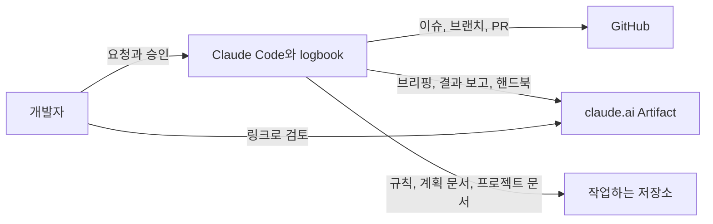

<!-- logbook:system sources="README.md .claude-plugin/** skills/** agents/**" -->
# logbook

> 핸드북: https://claude.ai/artifact/LcZsiBL2JBbpMfePNVjGUh · 저장소: https://github.com/dincal/agent_logbook

## 한눈에 보기

logbook은 Claude Code에 설치하는 플러그인입니다. 개발은 에이전트가 맡고, 사람은 구현 전 브리핑과 구현 후 결과 보고만 검토합니다.

- **6** 명령(스킬): rulebook · discuss · brief · mission · debrief · sync
- **2** 자동 검사(hook): 플랜 미리보기 · 결과 보고 확인
- **4** 하위 에이전트(세션이 따로 띄우는 에이전트): 리뷰어와 구현 트랙을 맡는 builder 세 등급
- **3** 사람이 보는 페이지: 브리핑 · 결과 보고 · 프로젝트 핸드북

- 데이터베이스는 쓰지 않습니다. 작업 기록은 GitHub 이슈와 PR, 저장소의 문서(`docs/plans/`, `docs/system/`), 로컬 폴더 `.logbook/`에 남습니다.

## 시스템 지도

개발자가 Claude Code에게 일을 맡기면, logbook은 그 과정을 GitHub 이슈와 PR, claude.ai의 보고 페이지로 남깁니다.

- Artifact는 claude.ai에 올리는 비공개 웹 페이지입니다. Artifact를 쓸 수 없는 환경에서는 로컬 HTML 파일 경로를 링크로 씁니다.
- hook은 Claude Code가 특정 순간(플랜 제출, 대화 종료)에 자동으로 실행하는 스크립트입니다.

## 바꾸기 어려운 선택과 위험

작업 흐름은 모든 세션이 읽는 규칙과 자동 실행되는 hook으로 지키고, 보고는 슬라이드 형식의 HTML로 합니다.

| 선택 또는 위험 | 내용 | 근거 |
|---|---|---|
| 흐름은 AGENTS.md 규칙과 hook으로 지킨다 | 스킬은 절반 넘게 스스로 불리지 않습니다. 그래서 늘 지켜야 할 흐름은 매 세션 읽히는 규칙 블록과 확실하게 실행되는 hook에 둡니다 | [v0.1 계획](https://github.com/dincal/agent_logbook/blob/main/docs/plans/1-logbook-v0-1.md) |
| 보고는 HTML 슬라이드로, Artifact 링크로 공유한다 | 긴 문서 대신 짧은 슬라이드로 보고하고, 링크를 GitHub 이슈와 PR에 겁니다 | [v0.1 계획](https://github.com/dincal/agent_logbook/blob/main/docs/plans/1-logbook-v0-1.md) |
| 무인 실행은 Claude Code의 `/goal`에 맡긴다 | logbook은 목표 문장만 만들고, 끝났는지는 `/goal`의 평가 모델이 판단합니다 | [v0.1 계획](https://github.com/dincal/agent_logbook/blob/main/docs/plans/1-logbook-v0-1.md) |
| 흐름이 달라지는 선택은 사람에게 묻는다 | 에이전트가 스펙을 임의로 정하지 않도록, 사용 흐름이 달라지는 부분은 질문으로 정합니다 | [#3 계획](https://github.com/dincal/agent_logbook/blob/main/docs/plans/3-system-docs-and-design.md) |
| md 문서에는 HTML을 넣지 않는다 | 계획 문서와 프로젝트 문서는 md 뷰어에서도 읽히도록 mermaid, 표, 목록만 씁니다. 슬라이드의 숫자 타일 같은 HTML은 렌더러가 만들고, HTML이 든 md는 렌더러가 거부합니다 | [#7 이슈](https://github.com/dincal/agent_logbook/issues/7) |
| 이슈는 남길 일에만 만든다 | 다른 개발자가 알아야 하거나 꼭 남길 작업만 이슈가 됩니다. 작은 수정은 이슈 없이 PR만 열고, 따라오는 문서 갱신은 관련 작업의 PR에 얹으며, 저장소를 고치지 않는 로컬 작업은 채팅으로만 보고합니다 | [#13 계획](https://github.com/dincal/agent_logbook/blob/main/docs/plans/13-issue-worthy-only.md) |
| 에픽은 에픽 브랜치에서 한 번에 진행한다 | `/goal` 세션 하나가 단계 PR을 에픽 브랜치에 합치고, 사람은 에픽 브리핑과 에픽 결과 보고만 봅니다. 완료 조건이 ❌이거나 확인된 심각한 지적이 남으면 그 단계에서 멈춥니다 | [#15 계획](https://github.com/dincal/agent_logbook/blob/main/docs/plans/15-epic-branch.md) |
| 병렬 작업은 서브에이전트나 Workflow로 띄운다 | 트랙이나 조사 영역이 셋 이상이거나 긴 작업이면 Workflow, 아니면 서브에이전트입니다. 어느 쪽이든 같은 모델 등급을 쓰고, Workflow를 쓸 수 없으면 서브에이전트로 띄웁니다 | [#15 계획](https://github.com/dincal/agent_logbook/blob/main/docs/plans/15-epic-branch.md) |
| 위험: md 뷰어가 mermaid를 그려야 그림이 보인다 | GitHub와 흔한 편집기는 mermaid를 그리지만, 지원하지 않는 뷰어에서는 그림이 코드로 보입니다. 슬라이드에서는 늘 그림으로 보입니다 | `templates/diagram-kit.md` |
| 위험: Artifact와 `/design`은 조건이 있다 | claude.ai 로그인, Anthropic API, 대화형 세션이 필요합니다. `claude -p` 같은 무인 실행에서는 게시하지 못합니다 | [#3 계획](https://github.com/dincal/agent_logbook/blob/main/docs/plans/3-system-docs-and-design.md) |

## 용어

logbook에서 쓰는 말 열두 개입니다.

| 용어 | 쉬운 설명 | 코드에서 부르는 이름 |
|---|---|---|
| 브리핑 | 구현 전에 올리는 계획 보고 슬라이드 | 계획 문서의 `brief` 블록, `/brief` |
| 결과 보고(디브리핑) | PR을 연 뒤 올리는 결과 보고 슬라이드 | 계획 문서의 `debrief` 블록, `/debrief` |
| 계획 문서 | 변경마다 하나씩 쓰는 문서. 브리핑과 결과 보고의 원본입니다 | `docs/plans/<번호>-<slug>.md` |
| 프로젝트 문서 | 지금 시스템을 설명하는 문서(한눈에 보기, 기술 스택, 주요 흐름, 데이터 모델) | `docs/system/` |
| 핸드북 | 프로젝트 문서를 슬라이드 하나로 묶은 웹 페이지 | `scripts/render-system.sh` |
| 규칙 블록 | 프로젝트의 AGENTS.md에 설치되는 logbook 작업 규칙 | `templates/agents-block.md` |
| 시안 | 화면을 구현하기 전에 승인받는 화면 그림. Claude Code의 `/design` 캔버스로 만듭니다 | `docs/designs/<번호>-<slug>/` |
| 옛 흔적 | 예전 에이전트 도구(paperclip 등)가 남긴 파일과 규칙 | `scripts/legacy-scan.sh` |
| 트랙 | 구현을 나눴을 때 한 에이전트가 맡는 독립된 부분. 다른 트랙과 파일이 겹치지 않습니다 | 규칙 블록의 "구현은 이득이 있을 때만 나눈다" |
| 에픽 | 여러 단계(하위 이슈)로 나뉜 긴 작업. `epic` 라벨이 붙고 `epic/<번호>-<slug>` 브랜치에서 진행합니다 | `skills/mission/SKILL.md`의 Epics 절 |
| Workflow | 여러 하위 에이전트를 JavaScript 스크립트 하나로 순서대로, 동시에 띄우는 Claude Code 도구 | `templates/parallel.md` |
| builder | 트랙 하나를 맡아 구현하는 하위 에이전트. 모델과 effort에 따라 세 등급(builder-fast, builder, builder-deep)이 있습니다 | `agents/builder*.md` |
