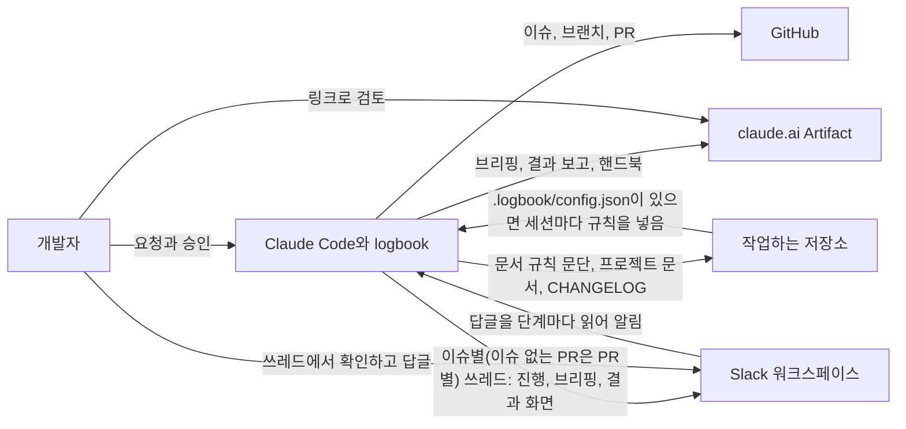

<!-- logbook:system sources="README.md .claude-plugin/** skills/** agents/** hooks/** templates/session-rules.md templates/docs-rules.md" checked="2026-10-21" -->
# logbook

> 핸드북: https://claude.ai/artifact/LcZsiBL2JBbpMfePNVjGUh · 저장소: https://github.com/dincal/agent_logbook

## 한눈에 보기

logbook은 Claude Code에 설치하는 플러그인입니다. 개발은 에이전트가 맡고, 사람은 자기가 정할 결정에 답하고 구현 전 브리핑과 구현 후 결과 보고만 검토합니다.

- **6** 명령(스킬): rulebook · discuss · brief · build · debrief · sync
- **3** hook(자동으로 실행되는 스크립트): 세션 규칙 · 플랜 검사 · 결과 보고 확인
- **5** 하위 에이전트(세션이 따로 띄우는 에이전트): 리뷰어, 독립 점검(checker), 구현 트랙을 맡는 builder 세 등급
- **3** 사람이 보는 페이지: 브리핑 화면 · 결과 화면 · 프로젝트 핸드북

- 데이터베이스는 쓰지 않습니다. 작업 기록은 GitHub 이슈와 PR, 저장소의 문서(`docs/system/`, `CHANGELOG.md`), 로컬 폴더 `.logbook/`에 남습니다. 계획 문서와 시안 사본은 `.logbook/`에만 둡니다.

## 시스템 지도

개발자가 Claude Code에게 일을 맡기면, logbook은 그 과정을 GitHub 이슈와 PR, claude.ai의 보고 페이지로 남깁니다.

- Artifact는 claude.ai에 올리는 비공개 웹 페이지입니다. Artifact를 쓸 수 없는 환경에서는 로컬 HTML 파일 경로를 링크로 씁니다.
- Slack은 선택 연결입니다. 저장소 AGENTS.md에 Slack 채널 줄이 있거나 환경 변수 `LOGBOOK_SLACK_CHANNEL`이 있을 때만 이슈마다 쓰레드를 하나 만들어 진행 상황과 시안, 브리핑·결과 화면(PNG와 HTML)을 단계별 큰 제목을 단 글로 올리고, 첫 메시지에 지금 단계(계획, 만들기, 확인, 반영)를 보입니다. 이슈 없는 PR은 PR마다 쓰레드를 열어 무엇을 바꾸는지와 반영 완료 두 글만 올리고, 단계는 확인과 반영 두 칸만 보입니다. 쓰레드에 달린 답글은 단계가 바뀔 때 읽어 사용자에게 알리고, 계획에 반영할지는 사용자가 정합니다(자세한 흐름은 주요 흐름의 "Slack 쓰레드").
- hook은 Claude Code가 특정 순간(세션 시작, 플랜 제출, 대화 종료)에 자동으로 실행하는 스크립트입니다.
- logbook 작업 규칙은 저장소에 복사하지 않습니다. 세션이 시작될 때마다 플러그인이 넣으므로, 플러그인을 올리면 모든 프로젝트에 바로 적용됩니다.

## 바꾸기 어려운 선택과 위험

작업 흐름은 모든 세션이 읽는 규칙과 자동 실행되는 hook으로 지키고, 보고는 이슈마다 그림으로 설계한 화면으로 합니다.

| 선택 또는 위험 | 내용 | 근거 |
|---|---|---|
| 흐름은 세션마다 들어가는 규칙과 hook으로 지킨다 | 스킬은 절반 넘게 스스로 불리지 않습니다. 그래서 늘 지켜야 할 흐름은 매 세션 컨텍스트에 들어가는 규칙과 확실하게 실행되는 hook에 둡니다. 규칙은 프로젝트에 복사하지 않고 SessionStart hook이 플러그인에서 넣으므로, 규칙이 바뀌어도 프로젝트마다 할 일이 없습니다 | [v0.1 PR](https://github.com/dincal/agent_logbook/pull/2), [#20 PR](https://github.com/dincal/agent_logbook/pull/21) |
| logbook은 clone마다 `/rulebook`으로 켠다 | 켜는 표시 `.logbook/config.json`은 git에서 제외되어 clone에 따라오지 않습니다. 그래서 logbook이 없는 사람에게는 logbook 규칙이 보이지 않고, 새로 clone하면 `/rulebook`을 한 번 실행해야 합니다. 잊어도 경고하지 않습니다 | [#20 PR](https://github.com/dincal/agent_logbook/pull/21) |
| 문서 규칙은 프로젝트의 AGENTS.md에 둔다 | 문서와 위치 표, 코드와 함께 고치는 약속은 logbook이 없는 사람도 지킬 프로젝트의 약속이라 AGENTS.md의 일반 문단으로 둡니다. logbook은 그 표의 위치를 따르고, 문단을 다시 쓰지 않습니다 | [#20 PR](https://github.com/dincal/agent_logbook/pull/21) |
| 보고는 이슈마다 그림으로 설계한 화면으로, 글은 채팅과 이슈 본문에 둔다 | 고정된 글 슬라이드는 읽히지 않아서, 브리핑과 결과 보고는 이슈마다 그림으로 설명하는 화면을 따로 설계하고 Artifact 링크로 GitHub 이슈와 PR에 겁니다. 버튼과 움직임은 꼭 필요할 때만 씁니다. 글 브리핑은 다른 개발자가 읽도록 이슈 본문에 두고, 승인은 채팅에서 받습니다. 화면은 승인한 순간의 기록으로 고정합니다 | [v0.1 PR](https://github.com/dincal/agent_logbook/pull/2), [#31 이슈](https://github.com/dincal/agent_logbook/issues/31) |
| 브리핑과 결과 화면은 공개 링크 대신 Slack 워크스페이스에 올린다 | 개인 플랜의 Artifact는 "링크가 있으면 누구나" 여는 공개 링크로만 공유할 수 있어서 회사 사람에게만 보이게 제한할 수 없습니다. 브리핑에는 DB 스키마와 위험 항목이 들어가므로, 접근 범위가 워크스페이스로 정해진 Slack 쓰레드에 PNG와 HTML로 올립니다. Artifact는 작성자 본인이 보는 용도로 그대로 둡니다. 채널 줄도 환경 변수 `LOGBOOK_SLACK_CHANNEL`도 없는 저장소는 올리지 않습니다 | [#34 이슈](https://github.com/dincal/agent_logbook/issues/34) |
| 승인한 계획은 `/build`가 끝까지 진행한다 | 브리핑을 승인하면 `/brief`가 `/build`로 넘기고, `/build`가 다시 승인을 묻지 않고 트랙 그래프대로 만들어 PR과 결과 보고까지 갑니다. `status:in-progress`인 이슈만 실행하고, 끊기면 `/build #번호`로 이어 갑니다. 계획 문서는 커밋하지 않으므로 계획을 세운 기기에서만 이어 갈 수 있습니다 | [#17 PR](https://github.com/dincal/agent_logbook/pull/19), [#31 이슈](https://github.com/dincal/agent_logbook/issues/31) |
| 사람이 정할 결정은 모두 객관식으로 묻고, 계획 전에 한 번 더 점검한다 | 에이전트가 스펙을 임의로 정하지 않도록, 쓰는 방식, 도메인 규칙과 예외 상황, 득실이 있는 기술 선택은 네 관점(구조, 동작, 기술, 계약)으로 찾아 질문 도구로 묻습니다. 계획 문서를 쓰기 전에 대화를 보지 않은 `logbook:checker`가 짐작한 결정과 빠진 결정을 찾아 다시 묻게 합니다. 질문이 늘어나는 대신, 이미 정해진 것과 조정값은 묻지 않습니다 | [#3 PR](https://github.com/dincal/agent_logbook/pull/4), [#31 이슈](https://github.com/dincal/agent_logbook/issues/31) |
| md 문서에는 HTML을 넣지 않는다 | 계획 문서와 프로젝트 문서는 md 뷰어에서도 읽히도록 mermaid, 표, 목록만 씁니다. 핸드북의 숫자 타일 같은 HTML은 렌더러가 만들고, HTML이 든 플랜은 플랜 hook이, HTML이 든 프로젝트 문서는 `system-check.sh`가 걸러 냅니다 | [#7 이슈](https://github.com/dincal/agent_logbook/issues/7) |
| 이슈는 남길 일에만 만든다 | 다른 개발자가 알아야 하거나 꼭 남길 작업만 이슈가 됩니다. 작은 수정은 이슈 없이 PR만 열고, 따라오는 문서 갱신은 관련 작업의 PR에 얹으며, 저장소를 고치지 않는 로컬 작업은 채팅으로만 보고합니다 | [#13 PR](https://github.com/dincal/agent_logbook/pull/14) |
| 병렬 작업은 서브에이전트나 Workflow로 띄운다 | `/build`는 builder 트랙이 있는 묶음마다 트랙 수와 상관없이 Workflow로 돌리고(크기 설정을 넘으면 여러 번에 나눠), 묶음 사이의 합치기와 전체 테스트는 세션이 합니다. 나눠 보는 리뷰는 Workflow로, 조사는 영역이 셋 이상이면 Workflow, 아니면 서브에이전트입니다. 어느 쪽이든 같은 모델 등급을 쓰고, Workflow를 쓸 수 없으면 서브에이전트로 띄웁니다 | [#15 PR](https://github.com/dincal/agent_logbook/pull/16), [#31 이슈](https://github.com/dincal/agent_logbook/issues/31) |
| 작업은 원래 checkout에서 하고, worktree는 병렬 개발과 물어본 경우에만 만든다 | 이슈는 원래 checkout에서 브랜치만 바꿔 진행합니다. 트랙마다 전체 테스트가 필요하면 `.logbook/worktrees/`에 worktree를 만들고 합친 뒤 바로 지웁니다. 원래 checkout을 쓰면 안 될 이유가 보이면 worktree를 만들기 전에 묻습니다 | [#27 PR](https://github.com/dincal/agent_logbook/pull/28) |
| 요청 하나는 이슈 하나, PR 하나로 하고, 그 안을 트랙 그래프로 나눈다 | 단계마다 이슈, PR, 리뷰, 머지가 한 번씩 더 들어서 하위 이슈와 단계를 두지 않습니다. 관련 없는 기능이 섞인 요청도 이슈 하나입니다. `/brief`가 계획 문서에 트랙 그래프(묶음, 트랙, 맡을 에이전트, 파일, 기다리는 트랙, 위험, 확인 명령)를 쓰고 사람에게는 묻지 않습니다. 그래프에 위험으로 표시한 트랙(까다로운 로직, 다른 트랙이 기대는 계약, 예외가 많은 수정)은 합치기 전에 리뷰하고, 묶음마다 전체 테스트를 돌리며, 트랙마다 커밋해 merge commit에서 트랙 하나만 되돌릴 수 있게 합니다. 대신 PR이 커지므로 큰 PR은 영역별 리뷰어와 이음새 리뷰어가 나눠 봅니다 | [#29 PR](https://github.com/dincal/agent_logbook/pull/30), [#31 이슈](https://github.com/dincal/agent_logbook/issues/31) |
| 계획 문서와 시안 사본은 저장소에 두지 않는다 | 계획 문서와 승인된 시안 사본은 원래 checkout(git worktree가 아닌 처음 clone한 폴더)의 `.logbook/plans/`, `.logbook/designs/`에 두고 커밋하지 않습니다. 저장소에는 logbook이 없는 사람도 읽을 문서만 남기고, 결정 이유는 PR 본문에, 변경 이력은 CHANGELOG에 이슈와 PR 링크로 남깁니다. 그 기기를 잃으면 계획 문서도 사라지므로, 미뤄 둔 계획은 이슈 댓글로 남깁니다 | [#25 PR](https://github.com/dincal/agent_logbook/pull/26) |
| 위험: md 뷰어가 mermaid를 그려야 그림이 보인다 | GitHub와 흔한 편집기는 mermaid를 그리지만, 지원하지 않는 뷰어에서는 그림이 코드로 보입니다. 핸드북에서는 늘 그림으로 보입니다 | `templates/diagram-kit.md` |
| 위험: 다른 기기에서는 진행 중인 작업을 이어 갈 수 없다 | 계획 문서와 `/build`의 진행 기록은 계획을 세운 기기에만 있습니다. 다른 기기에서는 이슈를 `status:todo`로 돌리고 다시 계획해야 합니다 | [#31 이슈](https://github.com/dincal/agent_logbook/issues/31) |
| 위험: Artifact와 `/design`은 조건이 있다 | claude.ai 로그인, Anthropic API, 대화형 세션이 필요합니다. `claude -p` 같은 무인 실행에서는 게시하지 못합니다 | [#3 PR](https://github.com/dincal/agent_logbook/pull/4) |

## 용어

logbook에서 쓰는 말 열여덟 개입니다.

| 용어 | 쉬운 설명 | 코드에서 부르는 이름 |
|---|---|---|
| 브리핑 | 구현 전에 올리는 계획 보고. 이슈 본문의 글 브리핑과 그림으로 된 브리핑 화면으로 나뉩니다 | 계획 문서의 `brief` 블록, `/brief` |
| 브리핑 화면 | 브리핑과 결과 보고를 이슈마다 그림으로 설계한 웹 페이지. 정해진 틀이 없고, 승인한 뒤에는 고치지 않습니다 | `templates/briefing.md`, `.logbook/briefs/` |
| 결과 보고(디브리핑) | PR을 연 뒤 올리는 결과 보고. 그림으로 된 결과 화면과 PR 본문의 글로 나뉩니다 | 계획 문서의 `debrief` 블록, `/debrief` |
| 계획 문서 | 변경마다 하나씩 쓰는 문서. 브리핑과 결과 보고의 원본이고, 커밋하지 않습니다 | `.logbook/plans/<번호>-<slug>.md` |
| 프로젝트 문서 | 지금 시스템을 설명하는 문서(한눈에 보기, 기술 스택, 주요 흐름, 업무 규칙, 데이터 모델) | `docs/system/` |
| 업무 규칙 문서 | 사람이 정했거나 확인한 도메인 규칙, 하면 안 되는 것, 예외 상황의 처리를 모은 프로젝트 문서. 도메인 규칙이 있는 프로젝트에만 둡니다 | 프로젝트 문서 폴더의 `rules.md`, 뼈대 `templates/system/rules.md` |
| 핸드북 | 프로젝트 문서를 슬라이드 하나로 묶은 웹 페이지 | `scripts/render-system.sh` |
| logbook 규칙 | SessionStart hook이 세션마다 넣는 logbook 작업 규칙과 트래커 정보. 0.7 이전에는 AGENTS.md에 복사하는 규칙 블록이었습니다 | `templates/session-rules.md`, `hooks/session-rules.sh` |
| 문서 규칙 문단 | 프로젝트의 AGENTS.md에 두는 문서와 위치 표. logbook과 상관없는 프로젝트의 약속입니다 | `templates/docs-rules.md` |
| 시안 | 화면을 구현하기 전에 승인받는 화면 그림. Claude Code의 `/design` 캔버스로 만들고, 승인본의 사본은 커밋하지 않습니다 | `.logbook/designs/<번호>-<slug>/` |
| 변경 이력 | 쓰는 사람이 알아챌 변경을 PR마다 한 줄씩, 이슈와 PR 링크와 함께 버전별이나 날짜별로 쌓는 파일 | `CHANGELOG.md`, `/debrief` |
| 트랙 | 구현을 나눴을 때 한 에이전트가 맡는 독립된 부분. 같은 묶음의 다른 트랙과 파일이 겹치지 않습니다 | logbook 규칙의 "독립 트랙은 나눠서 동시에 만든다" |
| 트랙 그래프 | `/brief`가 계획 문서 `## 상세`에 쓰는 구현 계획. 트랙마다 묶음, 맡을 에이전트, 바꿀 파일, 기다리는 트랙, 위험, 확인 명령을 적고, `/build`가 그대로 따릅니다 | `templates/parallel.md`의 "Track graph", `skills/build/SKILL.md` |
| 묶음 | 트랙 그래프에서 동시에 만드는 트랙의 모임. 묶음 0은 세션이 먼저 만드는 공통 부분이고, 묶음마다 합친 뒤 전체 테스트를 돌립니다 | 트랙 그래프의 "묶음" 열 |
| 독립 점검(checker) | 계획 문서를 쓰기 전에 대화 원문과 결정 목록을 읽고, 근거 없는 결정과 빠진 결정을 질문으로 돌려주는 읽기 전용 하위 에이전트 | `agents/checker.md`, `templates/questions.md`의 "Independent check" |
| worktree | 한 저장소를 여러 폴더에 동시에 checkout하는 git 기능. logbook은 병렬 트랙과 사람이 고른 경우에만 원래 checkout의 `.logbook/worktrees/`에 만듭니다 | `scripts/worktree.sh` |
| Workflow | 여러 하위 에이전트를 JavaScript 스크립트 하나로 순서대로, 동시에 띄우는 Claude Code 도구 | `templates/parallel.md` |
| builder | 트랙 하나를 맡아 구현하는 하위 에이전트. 모델과 effort에 따라 세 등급(builder-fast, builder, builder-deep)이 있습니다 | `agents/builder*.md` |
