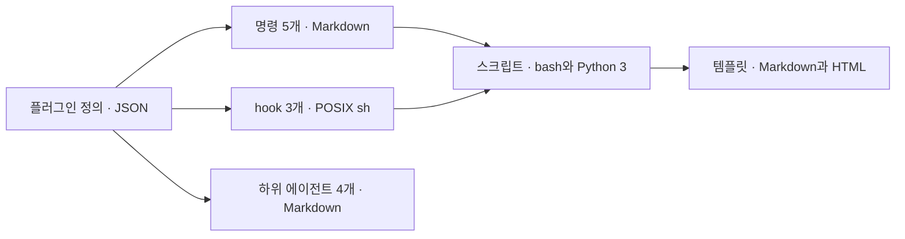

<!-- logbook:system sources=".claude-plugin/** hooks/** scripts/** templates/** tests/** agents/**" checked="2026-10-08" -->
# 기술 스택

## 구성과 기술 스택

logbook은 실행 서버 없이 Claude Code 안에서 동작하는 파일 묶음이고, 명령 설명서, hook, 스크립트, 템플릿으로 나뉩니다.

| 조각 | 기술 | 하는 일 | 고른 이유 |
|---|---|---|---|
| 플러그인 정의 | JSON(`.claude-plugin/plugin.json`, `.claude-plugin/marketplace.json`) | 이름, 버전, 설치 정보 | Claude Code와 Codex가 같은 파일로 설치합니다 |
| 명령 5개 | Markdown(`skills/<이름>/SKILL.md`) | rulebook, discuss, brief, debrief, sync의 절차 | 에이전트가 읽는 설명서라서 코드가 필요 없습니다 |
| hook 3개 | POSIX sh와 jq(없으면 python3), 공통 함수 `hooks/lib.sh` | 세션 규칙 넣기, 플랜 미리보기, 결과 보고 확인 | 어느 환경에서나 도는 가장 흔한 셸입니다. 세션 규칙 hook은 규칙 원문을 채울 때 python3를 씁니다 |
| 스크립트 | bash, Python 3 표준 라이브러리 | logbook 켜기와 옛 규칙 블록 옮기기, 브리핑과 핸드북 렌더, 문서와 코드 대조, 병렬용 git worktree 만들기와 지우기 | 따로 설치할 패키지가 없습니다 |
| 템플릿 | Markdown, HTML과 CSS | 계획 문서, 세션 규칙, 문서 규칙 문단, 슬라이드 모양, 프로젝트 문서의 뼈대, 글쓰기와 그림 안내, 병렬 실행 안내 | 한 곳을 고치면 모든 프로젝트에 적용됩니다 |
| 리뷰어 | Markdown(`agents/reviewer.md`) | PR을 새 컨텍스트에서 읽기만 하며 검토 | 품질 검사라 Claude Code에서는 Opus 모델, high effort로 실행합니다 |
| builder 3개 | Markdown(`agents/builder-fast.md`, `builder.md`, `builder-deep.md`) | 나눈 구현 트랙을 동시에 구현 | Agent 도구는 호출할 때 effort를 넘길 수 없어서 등급마다 파일을 따로 둡니다 |
| Workflow | Claude Code의 Workflow 도구(JavaScript 스크립트) | 트랙, 조사 영역, 나눠 보는 리뷰의 리뷰어가 셋 이상이거나 긴 작업일 때 에이전트를 한 스크립트로 띄움 | 트랙마다 결과를 정해진 형식으로 받고, 끊기면 이어서 실행합니다. 스크립트 틀은 `templates/parallel.md`에 있고, 쓸 수 없으면 서브에이전트로 띄웁니다 |

## 배포와 실행 환경

logbook은 GitHub 저장소를 플러그인 마켓플레이스로 등록해 설치하고, 사용자의 PC에서 Claude Code가 불러 씁니다.

- 마켓플레이스 갱신은 `claude plugin marketplace update agent-logbook`, 플러그인 갱신은 `claude plugin update logbook@agent-logbook`입니다.
- 쓰는 PC에는 git, GitHub CLI(`gh`), python3가 있어야 합니다. jq는 있으면 쓰고, 없으면 python3로 대신합니다.
- Artifact와 `/design`은 claude.ai에 로그인한 Claude Code에서만 됩니다. 다른 곳에서는 로컬 HTML 파일을 씁니다.
- 계획 문서, 승인된 시안 사본, 브리핑 HTML은 원래 checkout의 `.logbook/` 아래(`plans`, `designs`, `briefs`)에 두고 git에 올리지 않습니다. 다른 기기에서는 PR 본문, 이슈 댓글, Artifact 링크로 봅니다.

## AI 모델

logbook은 역할마다 모델을 정해 두고, 본 작업은 사용자가 고른 세션 모델에 맡깁니다.

| 모델 | 고르는 설정(기본값) | 쓰는 곳 | 부르는 방법 |
|---|---|---|---|
| Opus 5.5, high effort | `agents/reviewer.md`의 `model: opus`, `effort: high` | 구현 후 결과 보고의 별도 리뷰(큰 PR은 영역 리뷰와 이음새 리뷰로 나눠 동시에), 에픽 PR의 에픽 리뷰 | Claude Code 하위 에이전트, 리뷰를 셋 이상으로 나누면 Workflow. 다른 하네스에서는 세션 모델 |
| Sonnet 5.5 | `templates/parallel.md`의 모델 표(서브에이전트는 `model: sonnet`, Workflow는 `agent()`의 `model: 'sonnet'`) | `/discuss`, `/brief`, `/sync`의 코드 조사(Explore) | Claude Code 하위 에이전트나 Workflow. 다른 하네스에서는 세션 모델 |
| Sonnet 5.5, medium effort | `agents/builder-fast.md` | 규모는 있지만 정형화된 병렬 구현 트랙 | Claude Code 하위 에이전트나 Workflow(같은 `agentType`, `model`, `effort`) |
| 세션 모델, medium effort | `agents/builder.md`의 `model: inherit` | 범위가 분명한 병렬 구현 트랙 | Claude Code 하위 에이전트나 Workflow(같은 `agentType`, `model`, `effort`) |
| 세션 모델, xhigh effort | `agents/builder-deep.md`의 `model: inherit` | 까다로운 병렬 구현 트랙 | Claude Code 하위 에이전트나 Workflow(같은 `agentType`, `model`, `effort`) |
| 세션 모델 | 사용자가 Claude Code에서 고른 모델 | 모든 명령의 본 작업(조사 정리, 계획, 구현, 문서 작성) | Claude Code 세션 |

- effort는 모델이 얼마나 깊이 생각할지 정하는 단계입니다(low, medium, high, xhigh, max).
- 사용자가 환경 변수 `CLAUDE_CODE_SUBAGENT_MODEL`에 모델을 적고 `CLAUDE_CODE_SUBAGENT_MODEL_FORCE=1`을 켜면, 위 설정보다 그 모델이 앞섭니다. `FORCE` 없이 적기만 하면 위 설정이 앞섭니다.

## 개발 도구

테스트는 셸 스크립트 하나로 돌리고, 플러그인 구조는 Claude Code의 검사 명령으로 확인합니다.

| 할 일 | 명령 |
|---|---|
| 테스트 | `bash tests/run.sh`. 브리핑 렌더 검사는 `tests/fixtures/plan.md`를 예제로 씁니다 |
| 플러그인 구조 검사 | `claude plugin validate .` |
| 브리핑 렌더 | `scripts/render-brief.sh [--standalone] <계획 문서> brief <출력 파일>`. `--standalone`은 로컬에서 열 파일에 doctype을 붙입니다 |
| 핸드북 렌더 | `scripts/render-system.sh [--standalone] docs/system <출력 파일>` |
| 문서와 코드 대조 | `scripts/system-check.sh` |
| 병렬용 worktree | `scripts/worktree.sh add <브랜치> [<기준 브랜치>]`, `remove <브랜치> [--delete-branch]`, `path <브랜치>`. 원래 checkout의 `.logbook/worktrees/`에 만들고, 커밋하지 않은 변경이 있으면 지우지 않고(종료 코드 3), 합치지 않은 브랜치는 남깁니다(종료 코드 4) |
| 개발 환경 준비 | git, `gh`(GitHub CLI), `claude`(Claude Code CLI), bash, python3가 있으면 됩니다. hook은 jq가 없으면 python3로 대신하지만, `tests/run.sh`는 jq를 직접 부르므로 테스트를 돌리려면 jq도 필요합니다 |
