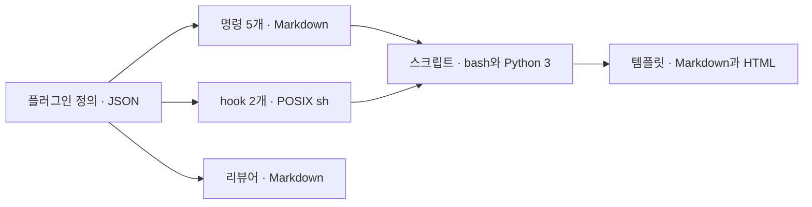

<!-- logbook:system sources=".claude-plugin/** hooks/** scripts/** templates/** tests/**" checked="2026-09-28" -->
# 기술 스택

## 구성과 기술 스택

logbook은 실행 서버 없이 Claude Code 안에서 동작하는 파일 묶음이고, 명령 설명서, hook, 스크립트, 템플릿으로 나뉩니다.



| 조각 | 기술 | 하는 일 | 고른 이유 |
|---|---|---|---|
| 플러그인 정의 | JSON(`.claude-plugin/plugin.json`, `.claude-plugin/marketplace.json`) | 이름, 버전, 설치 정보 | Claude Code와 Codex가 같은 파일로 설치합니다 |
| 명령 5개 | Markdown(`skills/<이름>/SKILL.md`) | rulebook, brief, mission, debrief, sync의 절차 | 에이전트가 읽는 설명서라서 코드가 필요 없습니다 |
| hook 2개 | POSIX sh와 jq(없으면 python3) | 플랜 미리보기, 결과 보고 확인 | 어느 환경에서나 도는 가장 흔한 셸입니다 |
| 스크립트 | bash, Python 3 표준 라이브러리 | 규칙 설치, 브리핑과 핸드북 렌더, 문서와 코드 대조, 옛 흔적 검사 | 따로 설치할 패키지가 없습니다 |
| 템플릿 | Markdown, HTML과 CSS | 계획 문서, 규칙 블록, 슬라이드 모양, 프로젝트 문서의 뼈대, 글쓰기와 그림 안내 | 한 곳을 고치면 모든 프로젝트에 적용됩니다 |
| 리뷰어 | Markdown(`agents/reviewer.md`) | PR을 새 컨텍스트에서 읽기만 하며 검토 | Claude Code에서는 Sonnet 모델, medium effort로 실행합니다 |

## 배포와 실행 환경

logbook은 GitHub 저장소를 플러그인 마켓플레이스로 등록해 설치하고, 사용자의 PC에서 Claude Code가 불러 씁니다.

```html
<div class="tracks">
  <div class="track"><div class="who">배포</div><div class="steps"><span class="step">PR 머지</span><span class="arrow">→</span><span class="step">마켓플레이스 갱신</span><span class="arrow">→</span><span class="step">플러그인 갱신</span><span class="arrow">→</span><span class="step done">새 세션에서 사용</span></div><div class="count">사용자 PC</div></div>
</div>
```

- 마켓플레이스 갱신은 `claude plugin marketplace update agent-logbook`, 플러그인 갱신은 `claude plugin update logbook@agent-logbook`입니다.
- 쓰는 PC에는 git, GitHub CLI(`gh`), python3가 있어야 합니다. jq는 있으면 쓰고, 없으면 python3로 대신합니다.
- Artifact와 `/design`은 claude.ai에 로그인한 Claude Code에서만 됩니다. 다른 곳에서는 로컬 HTML 파일을 씁니다.

## 개발 도구

테스트는 셸 스크립트 하나로 돌리고, 플러그인 구조는 Claude Code의 검사 명령으로 확인합니다.

| 할 일 | 명령 |
|---|---|
| 테스트 | `bash tests/run.sh` |
| 플러그인 구조 검사 | `claude plugin validate .` |
| 브리핑 렌더 | `scripts/render-brief.sh <계획 문서> brief <출력 파일>` |
| 핸드북 렌더 | `scripts/render-system.sh docs/system <출력 파일>` |
| 문서와 코드 대조 | `scripts/system-check.sh` |
