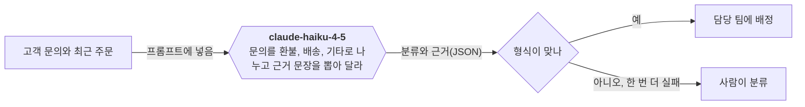

# Diagram kit

Show with a picture whatever content a picture can show. There is no quota in either direction: a section gets a picture because its content can be drawn, never to fill space, and content that no picture fits stays a table or text.

## Markdown only

Plan documents and project docs are read in markdown viewers (GitHub, editors) as often as in the project handbook, so a markdown file holds no HTML: no `html` or `svg` blocks and no tags such as `
` or ` `. HTML comments used as markers, such as `<!-- brief:begin -->`, stay, because viewers hide them. Draw with what a viewer shows, and let the handbook renderer add the HTML. Briefing and debriefing pages are HTML designed per issue (`templates/briefing.md`) and draw the same content in their own way:

| The content | Write it in markdown as | In the handbook it becomes |
|---|---|---|
| a flow, steps, a sequence, before and after, who acts at each step | a `mermaid` flowchart, sequence diagram or state diagram | the same diagram |
| database tables | a `mermaid` erDiagram | the same diagram |
| headline numbers | a list of two or more items that each start with a bold number: `- **9** 지운 파일: 옛 문서 4개, 규칙 사본 2개` | tiles: the number, the words before the colon, the words after it |
| the parts of a system, a comparison, options | a table | a table |

`render-brief.sh` and `render-system.sh` refuse a markdown file that carries HTML and name the lines, `system-check.sh` warns about it, and the plan hook sends such a plan back.

## Pictures that are never forced and never skipped

- **Flowchart**: a briefing or debriefing always shows the main logic the change adds or alters, such as a business rule, a flow between systems, a model call, or state changes that move money or data. Draw it in domain steps, not function names, with about ten elements at most. A procedure that does not matter to the reader gets no flowchart.
- **ERD**: a briefing or debriefing always shows a database schema change as an ERD of the changed tables and relations. The project docs (`docs/system/data-model.md`) show every table in the database, split by domain when there are many. Files, documents and anything else that is not a database table never go into an ERD, and a change without a schema change gets no ERD and no filler line about it.

## Model calls

A call to an LLM or another AI model gets its own node, so the reader sees what the system asks the model and what comes back:

- Draw the call as a hexagon whose label names the model and what the prompt asks it to do. The arrow into it says what goes into the prompt, and the arrow out of it says what comes back.
- Break a long label into lines with a markdown string, a label wrapped in backticks inside the quotes. It needs no ` `.
- Under the picture, a table gives each call its model and the setting that picks it, where the prompt lives, what goes in, what comes back and how it is checked, and what happens when the call fails.

| 모델 호출 | 모델(설정) | 넣는 것 | 요청(프롬프트 요지) | 받는 것과 검사 | 실패하면 |
|---|---|---|---|---|---|
| 문의 분류 | `claude-haiku-4-5`(`TRIAGE_MODEL`) | 문의 본문, 최근 주문 3건 | 세 갈래로 나누고 근거 문장을 뽑는다(`prompts/triage.md`) | JSON 스키마로 검사 | 한 번 다시 묻고, 또 틀리면 사람이 분류 |

## Writing mermaid

- One idea per diagram, about ten elements at most. Labels follow `templates/writing.md`: plain words a reader outside the project understands, and domain steps rather than function names.
- Quote labels that hold spaces or punctuation: `A["주문 접수"]`, `A -->|"결제 실패"| B`.
- Give a state with a non-ASCII name a plain id: `state "설명 중" as explaining`.
- Say a person's decision or a risk in words ("사람이 승인"), not with colors; page themes change colors.
