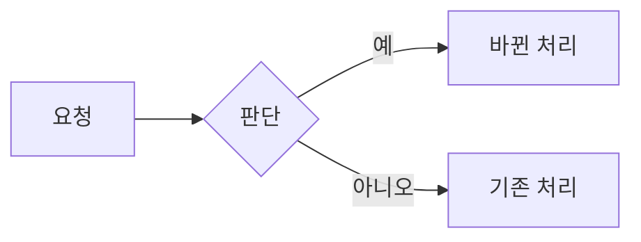
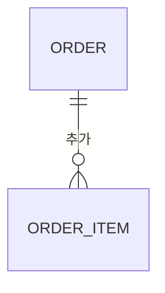
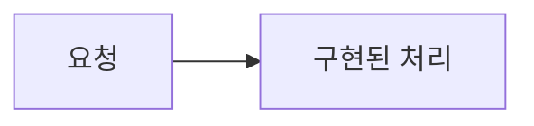

# {제목} (#{이슈번호})

> 상태: 브리핑 · 브리핑: {브리핑 링크} · 이슈: {이슈 링크} · PR: 구현 후 추가

<!-- brief:begin -->
## 요약

{이 장의 결론 한 문장. 각 절의 첫 문단은 그 장의 제목이 된다.}

- {숫자나 사실}
- {숫자나 사실}

> 요청: {사람에게 바라는 것. 예: 이 계획대로 진행해도 되는지 승인}

## 왜 하는가

{문제를 한 문장으로}

- {근거와 출처}

## 주요 로직 흐름

{바뀌는 주요 로직을 한 문장으로. 필수 슬라이드}



## 데이터 모델 변화

{ERD 변화를 한 문장으로. 필수 슬라이드. 바뀌지 않으면 그림 대신 아래 한 줄만 둔다}



> ERD 변화 없음: {이유}

<!-- 다른 슬라이드는 ```html 블록으로 자유 도식을 그린다(타일, 전후 트랙, 비교, 카드, SVG). templates/diagram-kit.md 참고. -->

## 주요 결정

{되돌리기 어려운 결정이 몇 개인지 한 문장으로}

| 결정 | 버린 대안 | 이유 |
|---|---|---|
| {에이전트가 정한 것은 "가정"으로 표시} | {대안} | {이유} |

## 리스크와 판단 필요

{막힐 수 있는 곳을 한 문장으로}

- {리스크}: {대응}

> 판단 필요: {없음, 또는 사람만 정할 수 있는 것 1~2개}

## 실행과 검증

{단계와 증명 방법을 한 문장으로}

1. {단계}
2. {단계}

| 완료 조건 | 증명 |
|---|---|
| {AC-1} | `{명령 또는 관찰}` |
<!-- brief:end -->

## 상세

### 조사 근거

- {`file:line` 또는 링크}

### 결정 기록

| 날짜 | 결정 | 이유 |
|---|---|---|

### 설계

### 단계

### 진행 기록

- [ ] {단계}

## Goal

<!-- /mission이 여기에 /goal 문장을 코드 블록으로 적는다. 쓰지 않으면 이 절을 지운다. -->

<!-- debrief:begin -->
## 결과

{무엇을 전달했는지 한 문장}

## 계획과 달라진 점

- {차이와 이유, 없으면 "없음"}

## 실제 흐름과 데이터 모델

{구현된 주요 로직 흐름과 ERD 변화를 한 문장으로. 코드에서 다시 그린다}



> ERD 변화 없음: {이유, 바뀌었으면 이 줄 대신 erDiagram}

## 검증 증거

| 기준 | 결과 | 증거 |
|---|---|---|
| {AC-1} | ✅ | `{명령}` → {출력 요약} |

## 리뷰 포인트

- `{file:line}`: {사람이 볼 이유}
- 리뷰 기록: {n}차, 지적 {a}건 중 고침 {b} · 반박 {c} · 남김 {d}

## 남은 리스크와 후속 이슈

- {없으면 "없음"}
<!-- debrief:end -->
