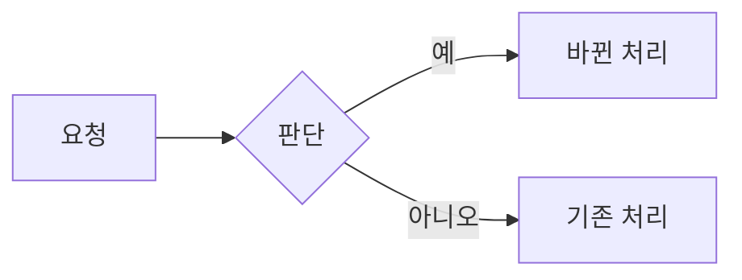
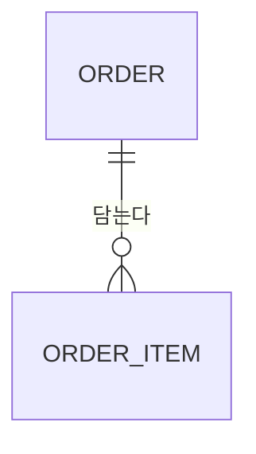
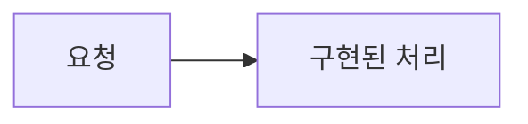

# {제목} (#{이슈번호})

> 상태: 브리핑 · 브리핑: {브리핑 링크} · 이슈: {이슈 링크} · 시안: {시안 링크, 화면을 바꾸지 않으면 이 항목을 지운다} · PR: 구현 후 추가

<!--
쓰는 법
- 브리핑 블록은 슬라이드가 된다. 상사에게 보고하듯 결론과 요청부터 쓴다. `##` 제목 하나가 한 장이고, 첫 문단은 그 장의 결론 한 문장이다.
- 글은 templates/writing.md, 그림은 templates/diagram-kit.md를 따른다. 그림으로 표현할 수 있는 것은 그림으로 표현하되, ERD와 흐름도는 억지로 그리지 않는다.
- 이 파일에는 HTML을 넣지 않는다. 그림은 mermaid로 그리고, 숫자는 굵은 숫자로 시작하는 목록으로 쓰면 슬라이드에서 타일이 된다.
- AI 모델을 부르는 로직이면 그림에 모델 이름과 프롬프트 요지(넣는 것, 요청, 받는 것)를 넣는다.
- 제목 뒤 괄호에 조건이 붙은 장은 그 조건에 해당할 때만 쓰고, 아니면 장을 통째로 지운다. 괄호는 지운다.
-->

<!-- brief:begin -->
## 요약

{결론 한 문장: 무엇을 왜 하려는지}

- **{숫자}** {무엇}: {설명}
- **{숫자}** {무엇}: {설명}

> 요청: {승인받고 싶은 것. 예: 이 계획대로 진행해도 될지 승인 부탁드립니다}

## 배경

{지금 무엇이 문제인지 한 문장}

- {근거와 출처}

## {하는 일}

{무엇을 바꾸는지 한 문장. 내용이 많으면 이 장을 여러 장으로 나눈다}

## 주요 로직 흐름 (주요 로직이 새로 생기거나 바뀔 때)

{바뀌는 로직을 한 문장으로}

## 데이터베이스 변경 (DB 스키마가 바뀔 때)

{바뀌는 테이블과 관계를 한 문장으로}

## 화면 시안 (화면을 새로 만들거나 크게 바꿀 때)

{승인한 시안이 무엇을 보여 주는지 한 문장}

- 시안: {캔버스 링크} · 사본: `docs/designs/{이슈번호}-{slug}/`
- 화면: {화면과 상태 목록}
- 승인: {날짜와 받은 의견}

## 단계 (에픽일 때)

{단계를 몇 개로 나누고 어떤 순서로 진행하는지 한 문장}

| 순서 | 단계 이슈 | 브랜치 | 기다리는 단계 | 전달하는 것 |
|---|---|---|---|---|
| 1 | #{번호} {제목} | `{type}/{번호}-{slug}` | 없음 | {무엇} |

- 에픽 브랜치: `epic/{에픽 번호}-{slug}`. 단계 PR은 이 브랜치를 향하고, 완료 조건을 채우면 에이전트가 squash로 합칩니다.

## 주요 결정

{사용자가 정한 것과 에이전트가 정한 것이 각각 몇 가지인지 한 문장으로}

| 사용자가 정한 것 | 버린 대안 |
|---|---|
| {질문으로 정한 것} | {대안} |

알린 우려: {사용자가 정했지만 근거와 어긋나 보여 알린 것과, 그대로 진행한 이유. 없으면 이 줄을 지운다}

에이전트가 정한 것(사용 흐름에 영향이 없는 것):

- {결정과 이유}

## 위험과 판단 필요

{막힐 수 있는 곳을 한 문장으로}

| 위험 | 대응 |
|---|---|
| {위험} | {대응} |

> 판단 필요: {없음, 또는 사람만 정할 수 있는 것 1~2개}

## 일정과 검증

{단계와 확인 방법을 한 문장으로}

{단계는 mermaid 흐름도(flowchart LR)로 그린다}

- 프로젝트 문서: {이 변경으로 고칠 docs/system 문서와 절, 없으면 "변경 없음"}

| 완료 조건 | 확인 방법 |
|---|---|
| {1. 완료 조건} | `{명령 또는 관찰}` |
<!-- brief:end -->

## 상세

### 조사한 내용

- {`file:line` 또는 링크}

### 결정 기록

| 날짜 | 결정 | 이유 |
|---|---|---|

### 설계

### 단계

### 진행 기록

- [ ] {단계}

<!-- debrief:begin -->
## 결과

{무엇을 전달했는지 한 문장}

- **{숫자}** {무엇}: {설명}
- **{숫자}** {무엇}: {설명}

## 단계 결과 (에픽일 때)

| 단계 | PR | 결과 | 리뷰 |
|---|---|---|---|
| {n}. #{번호} {제목} | {PR 링크} | {머지됨, 멈춤} | {차수와 지적 수} |

## 계획과 달라진 점

- {차이와 이유, 없으면 "없음"}

## 구현된 주요 로직 (주요 로직이 새로 생기거나 바뀌었을 때)

{구현된 로직을 한 문장으로. 코드에서 다시 그린다}

## 데이터베이스 변경 (DB 스키마가 바뀌었을 때)

{바뀐 테이블과 관계를 한 문장으로. 코드에서 다시 그린다}

## 검증 증거

| 기준 | 결과 | 증거 |
|---|---|---|
| {1. 완료 조건} | ✅ | `{명령}` → {출력 요약} |
| 프로젝트 문서 | ✅ | `system-check.sh --range origin/{PR의 base 브랜치}...HEAD` → {요약} |
| 화면 시안 (시안이 있을 때) | ✅ | {구현한 화면과 시안을 비교한 결과} |

## 리뷰 포인트

- `{file:line}`: {사람이 볼 이유}
- 리뷰 기록: {n}차({걸린 시간}), 지적 {a}건 중 고침 {b} · 반박 {c} · 남김 {d}
- 병렬 트랙: {builder 트랙마다 에이전트, 한 일, 확인 결과 또는 세션이 이어받음, 걸린 시간. 나누지 않았으면 이 줄을 지운다}

## 남은 위험과 후속 과제

- {없으면 "없음"}
<!-- debrief:end -->
