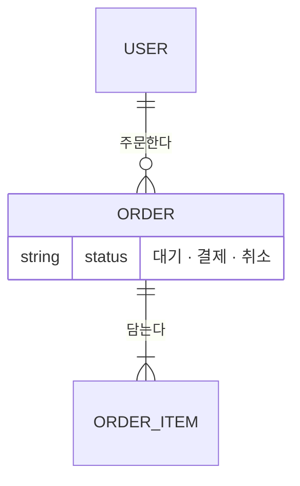

<!-- logbook:system sources="{스키마를 정의한 파일의 경로 패턴. 예: backend/app/models/** prisma/schema.prisma}" tables="{스키마에서 센 테이블 수}" -->
# 데이터 모델

<!-- DB가 있는 프로젝트에만 둔다. ERD에는 DB의 모든 테이블을 넣고, 테이블이 많으면 업무 영역별로 절을 나눠 모든 테이블이 적어도 한 그림에 나오게 한다. -->

## 전체 ERD

{테이블 {N}개가 어떻게 이어지는지 한 문장. 중심이 되는 테이블을 말한다}

## 테이블 설명

{테이블들이 무엇을 뜻하는지 한 문장}

| 테이블 | 뜻 | 주요 필드 | 만들고 바꾸는 곳 |
|---|---|---|---|
| {테이블} | {뜻} | {필드} | `{파일 경로}` |

## 상태 변화

{상태가 바뀌는 테이블과 그 규칙을 한 문장으로. 상태 값이 없으면 이 절을 지운다}

