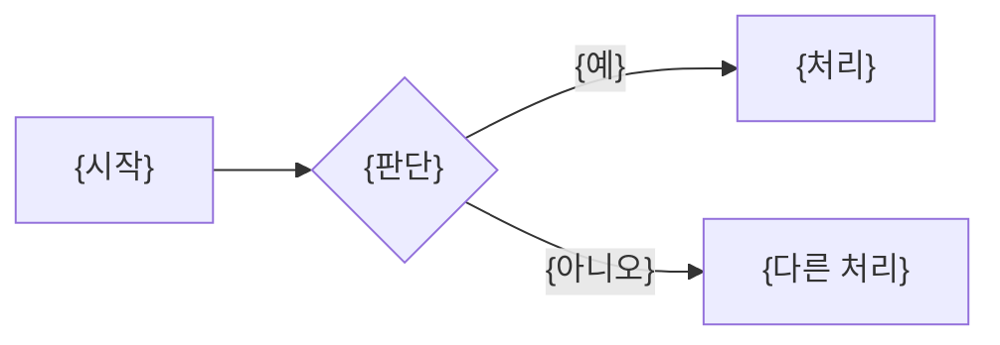

<!-- logbook:system sources="{흐름의 시작점과 핵심 로직이 있는 경로 패턴. 예: src/api/** src/services/**}" checked="{코드와 마지막으로 대조한 날짜}" -->
# 주요 흐름

## 흐름 목록

{이 시스템의 핵심 흐름 {N}개를 한 문장으로}

| 흐름 | 한 줄 설명 |
|---|---|
| {흐름 이름} | {한 줄 설명} |

## {흐름 이름}

{이 흐름이 무엇을 어떻게 처리하는지 한 문장}

- 실패하면: {사용자가 보는 결과와 시스템이 하는 일}
- 시작점: `{파일 경로}`의 `{함수나 클래스 이름}`
- 쓰는 데이터: {테이블 이름}

{AI 모델을 부르는 흐름이면 그림에 모델 호출을 육각형으로 넣고(templates/diagram-kit.md의 "Model calls"), 아래 표를 채운다. 부르지 않으면 표를 지운다}

| 모델 호출 | 모델(설정) | 넣는 것 | 요청(프롬프트 요지) | 받는 것과 검사 | 실패하면 |
|---|---|---|---|---|---|
| {이름} | `{모델}`(`{설정 이름}`) | {프롬프트에 넣는 입력} | {무엇을 시키는지, 프롬프트가 있는 곳} | {출력 형식과 검사} | {다시 묻기, 대체 모델, 사용자가 보는 것} |
