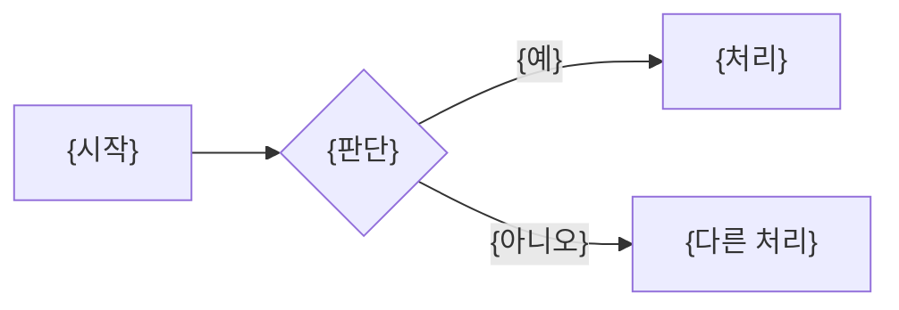

<!-- logbook:system sources="{흐름의 시작점과 핵심 로직이 있는 경로 패턴. 예: src/api/** src/services/**}" -->
# 주요 흐름

## 흐름 목록

{이 시스템의 핵심 흐름 {N}개를 한 문장으로}

```html
<div class="cards">
  <div class="card"><b>{흐름 이름}</b><p>{한 줄 설명}</p></div>
</div>
```

## {흐름 이름}

{이 흐름이 무엇을 어떻게 처리하는지 한 문장}



- 실패하면: {사용자가 보는 결과와 시스템이 하는 일}
- 시작점: `{파일 경로}`의 `{함수나 클래스 이름}`
- 쓰는 데이터: {테이블 이름}
