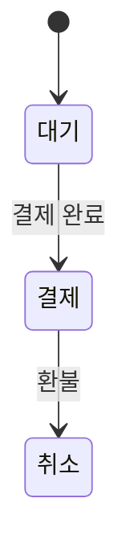

<!-- logbook:system sources="{규칙을 지키는 코드의 경로 패턴. 예: src/domain/** src/services/**}" checked="{코드와 마지막으로 대조한 날짜}" -->
# 업무 규칙

<!-- 도메인 규칙이 있는 프로젝트에만 둔다. 사용자가 정했거나 확인한 규칙(/brief의 질문이나 /sync의 확인)을 적고, 코드에서 추렸지만 아직 확인받지 못한 규칙에는 `확인 필요`를 붙인다. 지켜야 할 규칙이 아닌 동작, 코드가 보여 주기만 하는 동작은 적지 않는다. 규칙마다 지켜지는지 아닌지 가려낼 수 있게 쓰고, 해야 할 일과 하면 안 되는 일을 짝으로 적고, 예외 상황마다 구체적인 처리를 적는다. 계획했지만 아직 만들지 않은 기능은 영구 금지가 아니라 현재 상태로 적는다. -->

## {업무 영역}

{이 영역에서 반드시 지켜지는 규칙이 무엇인지 한 문장}

| 규칙 | 하면 안 되는 것 | 예외 상황과 처리 | 정한 곳 |
|---|---|---|---|
| {예: 결제가 끝난 주문만 배송을 시작한다} | {예: 결제 전 주문의 배송 시작} | {예: 결제 취소 요청이 겹치면 배송을 멈추고 환불한다} | {PR 링크 또는 `확인 필요`} |

## 상태 변화 규칙 (상태가 있을 때)

{어떤 상태가 어떤 조건에서만 바뀌는지 한 문장}

- 금지: {예: 취소에서 결제로 되돌리기}
- 금지: {예: 대기에서 결제를 거치지 않고 배송으로 넘어가기}

{상태가 없으면 이 절을 지운다}

## 용어 (같은 말이 다른 뜻으로 쓰일 때)

{이 프로젝트에서 뜻이 정해진 말이 무엇인지 한 문장}

| 용어 | 이 프로젝트에서의 뜻 | 헷갈리는 다른 뜻 |
|---|---|---|
| {용어} | {이 프로젝트에서의 뜻} | {흔히 쓰는 다른 뜻} |
