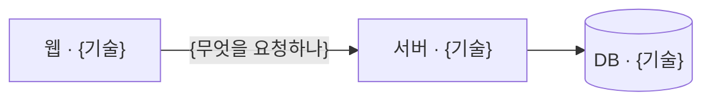

<!-- logbook:system sources="{기술 스택을 정하는 파일의 경로 패턴. 예: package.json pyproject.toml Dockerfile .github/workflows/**}" -->
# 기술 스택

## 구성과 기술 스택

{시스템이 몇 조각으로 나뉘고 각각 무엇으로 만들었는지 한 문장}



| 조각 | 기술 | 하는 일 | 고른 이유 |
|---|---|---|---|
| {웹} | {Next.js 15} | {화면} | {이유와 근거가 된 계획 문서 링크} |

## 배포와 실행 환경

{어디에서 어떻게 실행되는지 한 문장}

```html
<div class="tracks">
  <div class="track"><div class="who">배포</div><div class="steps"><span class="step">{로컬}</span><span class="arrow">→</span><span class="step">{스테이징}</span><span class="arrow">→</span><span class="step">{운영}</span></div><div class="count">{배포 방법}</div></div>
</div>
```

## 개발 도구

{테스트, 코드 검사, CI를 무엇으로 하는지 한 문장. 필요 없으면 이 절을 지운다}

| 할 일 | 명령 |
|---|---|
| {테스트} | `{명령}` |
