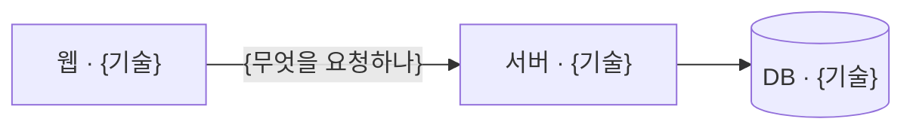
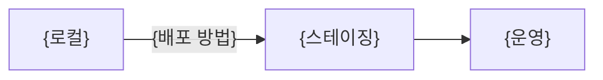

<!-- logbook:system sources="{기술 스택을 정하는 파일의 경로 패턴. 예: package.json pyproject.toml Dockerfile .github/workflows/**}" checked="{코드와 마지막으로 대조한 날짜}" -->
# 기술 스택

## 구성과 기술 스택

{시스템이 몇 조각으로 나뉘고 각각 무엇으로 만들었는지 한 문장}

| 조각 | 기술 | 하는 일 | 고른 이유 |
|---|---|---|---|
| {웹} | {Next.js 15} | {화면} | {이유와 근거가 된 PR 링크} |

## 배포와 실행 환경

{어디에서 어떻게 실행되는지 한 문장}

## AI 모델 (AI 모델을 부를 때)

{어떤 AI 모델을 어디에 쓰는지 한 문장. 모델을 부르지 않으면 이 절을 지운다}

| 모델 | 고르는 설정(기본값) | 쓰는 곳 | 부르는 방법 |
|---|---|---|---|
| {모델 이름} | `{설정 이름}`(`{기본값}`) | {흐름 이름과 단계} | {SDK, API, 하위 프로세스} |

## 개발 도구

{테스트, 코드 검사, CI를 무엇으로 하는지 한 문장. 필요 없으면 이 절을 지운다}

| 할 일 | 명령 |
|---|---|
| {테스트} | `{명령}` |
